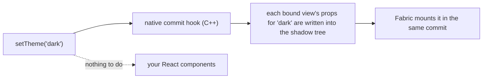
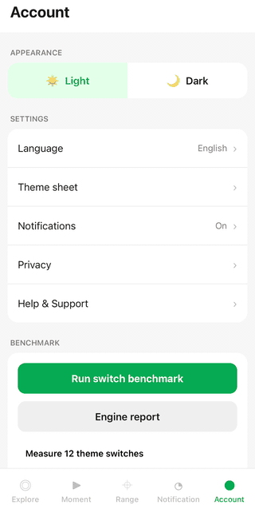
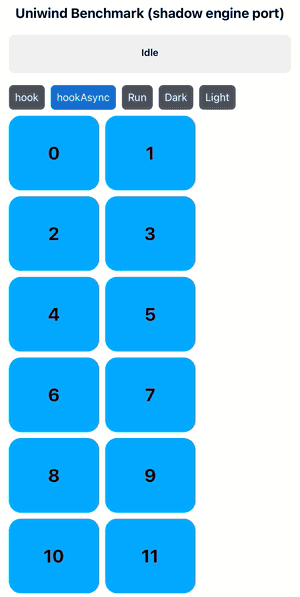

<div align="center">

# 🌗 shadewind

React Native 0.86 · New Architecture (Fabric) · iOS & Android · MIT · experimental

<p>
  <a href="docs/GUIDE.md">Guide</a> ·
  <a href="docs/BENCHMARK.md">Benchmark</a> ·
  <a href="docs/DEMO.md">Run the demo</a> ·
  <a href="docs/KNOWN_LIMITS.md">Known limits</a> ·
  <a href="docs/OVERVIEW.md">Architecture</a> ·
  <a href="docs/API.md">API</a>
</p>

</div>

## 📊 Benchmark

The [`uniwind-benchmarks`](https://github.com/uni-stack/uniwind-benchmarks) screen (thanks to the Uniwind team): 2003 views, one scenario
re-mounting them and one switching light and dark, ten runs each. Release builds, median of twelve warm launches, time until the JS thread is idle.

| | Mount 2003 views | Theme switch |
|---|---|---|
| iOS · `StyleSheet` (no styling library) | 38.94 ms | |
| iOS · Uniwind 1.12 | 64.31 ms | 105.86 ms |
| **iOS · Shadewind** | **49.93 ms** | **2.45 ms** |
| Android · `StyleSheet` (numeric colours) | 55.38 ms | |
| **Android · Shadewind 0.2.0** | **59 to 61 ms** | **0.14 ms** |

The theme column is JS-thread time only; the colours reach the screen about 47 ms (Android) to 57 ms (iOS) after the call, because the
main thread's mount is React Native's own work. iOS: iPhone 17 Pro simulator; Android: Pixel_8_Pro emulator; neither is a device.
Spreads, the method and what did not help: [docs/BENCHMARK.md](docs/BENCHMARK.md).

> 💚 **A note from the author.** Shadewind is vibe-coded with Claude Code by a dev who finds joy in programming. Take the code and numbers with a grain of salt, and kindly roast me where I’m wrong. 🤝

> **Status: experimental (0.x).** New Architecture only, React Native 0.86. iOS is the primary target; Android has less testing
> (one emulator, no physical device). Uniwind support is verified against Uniwind 1.12.x.

## ✨ What you get

- ⚡ **No re-render on a theme switch.** The new theme is applied to views that are already mounted, so your components stay put and
  the JS thread stays free.
- 🎨 **Works with your Uniwind `className`s.** They stay exactly as they are. The setup is two small changes (below).
- 🌗 **Optional animated switch.** `setTheme('dark', { transition: { type: 'fade', durationMs: 250 } })` cross-fades; instant by default.
- 🛠️ **See what the engine does.** A dev-only diagnostics log shows every view it binds and every commit it themes.
- 🧪 **Tested at the native level.** A harness runs React Native's real C++ renderer, so the commit logic is checked without a device.

## 🔧 How it works



Instead of asking every styled component to render again, shadewind remembers each view's props per theme and rewrites them
inside React Native's own shadow tree commit.

## 🚀 Quick start (with Uniwind)

```sh
npm install shadewind react-native-nitro-modules@^0.37.1
cd ios && pod install
```

shadewind is a [Nitro module](https://nitro.margelo.com): it needs `react-native-nitro-modules` 0.37.1 or newer in the 0.37 line
(the version it is built and tested with).

```diff
 // metro.config.js
 const { withUniwindConfig } = require('uniwind/metro');
+const { withShadewind } = require('shadewind/metro');

-module.exports = withUniwindConfig(config, { cssEntryFile: './global.css' });
+module.exports = withShadewind(withUniwindConfig(config, { cssEntryFile: './global.css' }));
```

```js
// index.js, after your app import
import { installUniwind } from 'shadewind/uniwind';

installUniwind();
```

That's it: your `className` code does not change. No Uniwind? shadewind also works on plain React Native, see the [guide](docs/GUIDE.md).

## 🎬 Demo

<div align="center">



</div>

The Account screen of the example app flipping between light and dark.

<div align="center">



</div>

The benchmark screen running ten switches of the 2003 views and showing its result.

## 🤝 Contributing

- [Development workflow](CONTRIBUTING.md#development-workflow)
- [Code of conduct](CODE_OF_CONDUCT.md)

## 📄 License

MIT
