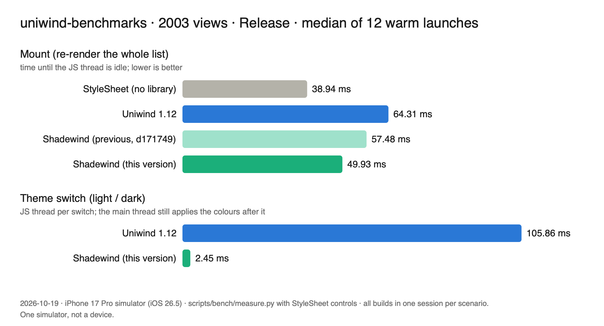
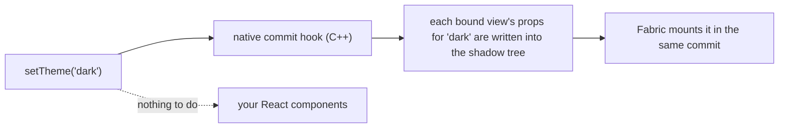

<div align="center">

# 🌗 shadewind

React Native 0.86 · New Architecture (Fabric) · iOS & Android · MIT · experimental

<p>
  <a href="docs/GUIDE.md">Guide</a> ·
  <a href="docs/BENCHMARK.md">Benchmark</a> ·
  <a href="docs/DEMO.md">Run the demo</a> ·
  <a href="docs/KNOWN_LIMITS.md">Known limits</a> ·
  <a href="docs/OVERVIEW.md">Architecture</a> ·
  <a href="docs/API.md">API</a>
</p>

</div>

## 📊 Benchmark


Thank you to the Uniwind team for publishing [`uniwind-benchmarks`](https://github.com/uni-stack/uniwind-benchmarks): we used its
2003-view screen, switched between light and dark. Here is what one switch costs, one strategy at a time:

| | JS thread busy | New theme on screen after |
|---|---|---|
| **Uniwind (plain)** | 107.94 ms | 111 ms |
| **`hookDeferred`** (what `Uniwind.setTheme` uses with shadewind) | 3.05 ms | 57 ms |
| **`hookAsync`** | **0.11 ms** | **57 ms** |

How to read it, step by step:

1. **Plain Uniwind** re-renders every component on the JS thread: busy for about 108 ms, and the cells show the new theme about 111 ms after the page background flips.
2. **`hookDeferred`** writes the new theme into the views that are already mounted: about 3 ms on the JS thread, and the cells show it at about 57 ms.
3. **`hookAsync`** gives the work to other threads: the JS thread is free after 0.11 ms. On screen it is not earlier: the cells show the new theme at about 57 ms, the same as `hookDeferred`. In a separate run (an earlier build) the main thread was busy for about 72 ms per switch with either strategy, so the remaining time looks like native work, not JavaScript. We have not traced it further.

So `hookAsync` frees the JS thread *when you switch*; it does not make the screen update sooner. For all engine runs we also checked that all 2003 views ended in the new theme.

All rows run the same 2003-view screen from this repository's `example-real` app (a port of the Uniwind benchmark, iOS simulator, Release build with dev tools on). "JS thread busy" is the median of six warm launches. "On screen" is measured from a screen recording: the time from the first frame that changes (the page background, taken as the moment of the `setTheme` call) to the frame where the cells change; one recording per row, median of its 10 switches. It is one simulator, not a device. One more caveat: with a component that reads the theme (`useCSSVariable`), `hookAsync` took about 12 ms of JS time on an earlier build; we did not re-measure that on the latest code. Details and how to repeat it: [docs/BENCHMARK.md](docs/BENCHMARK.md), or [run the 2003-view demo](docs/DEMO.md) yourself.

**The Uniwind benchmark app itself** (`uniwind-benchmarks`, its own measuring script: Release, iOS simulator, twelve warm launches
per build with StyleSheet control launches, all builds in one session):



| | Mount 2003 views | Theme switch (JS thread) |
|---|---|---|
| StyleSheet (no styling library) | 38.94 ms | |
| Uniwind 1.12 | 64.31 ms | 105.86 ms |
| **Shadewind** (this version) | **49.93 ms** | **2.45 ms** |

Mount is down from 57.48 ms in the previous version (same session). The theme column is JS time only, like the first table's left
column. Details, spreads and the method: [docs/BENCHMARK.md](docs/BENCHMARK.md#end-to-end-uniwind-benchmarks-render-and-theme-2026-10-19).

> 💚 **A note from the author.** Shadewind is vibe-coded with Claude Code by a dev who finds joy in programming. Take the code and numbers with a grain of salt, and kindly roast me where I’m wrong. 🤝

> **Status: experimental (0.x).** New Architecture only, React Native 0.86. iOS is the primary target; Android has less testing
> (one emulator, no physical device). Uniwind support is verified against Uniwind 1.12.x.

## ✨ What you get

- ⚡ **No re-render on a theme switch.** The new theme is applied to views that are already mounted, so your components stay put and
  the JS thread stays free.
- 🎨 **Works with your Uniwind `className`s.** They stay exactly as they are. The setup is two small changes (below).
- 🌗 **Optional animated switch.** `setTheme('dark', { transition: { type: 'fade', durationMs: 250 } })` cross-fades; instant by default.
- 🛠️ **See what the engine does.** A dev-only diagnostics log shows every view it binds and every commit it themes.
- 🧪 **Tested at the native level.** A harness runs React Native's real C++ renderer, so the commit logic is checked without a device.

## 🔧 How it works



Instead of asking every styled component to render again, shadewind remembers each view's props per theme and rewrites them
inside React Native's own shadow tree commit.

## 🚀 Quick start (with Uniwind)

```sh
npm install shadewind react-native-nitro-modules@^0.37.1
cd ios && pod install
```

shadewind is a [Nitro module](https://nitro.margelo.com): it needs `react-native-nitro-modules` 0.37.1 or newer in the 0.37 line
(the version it is built and tested with).

```diff
 // metro.config.js
 const { withUniwindConfig } = require('uniwind/metro');
+const { withShadewind } = require('shadewind/metro');

-module.exports = withUniwindConfig(config, { cssEntryFile: './global.css' });
+module.exports = withShadewind(withUniwindConfig(config, { cssEntryFile: './global.css' }));
```

```js
// index.js, after your app import
import { installUniwind } from 'shadewind/uniwind';

installUniwind();
```

That's it: your `className` code does not change. No Uniwind? shadewind also works on plain React Native, see the [guide](docs/GUIDE.md).

## 🎬 Demo

<div align="center">


</div>

The Account screen of the example app flipping between light and dark.

<div align="center">


</div>

The benchmark screen running ten switches of the 2003 views and showing its result.

## 🤝 Contributing

- [Development workflow](CONTRIBUTING.md#development-workflow)
- [Code of conduct](CODE_OF_CONDUCT.md)

## 📄 License

MIT
