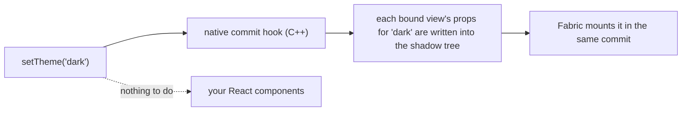

<div align="center">

# 🌗 shadewind

React Native 0.86 · New Architecture (Fabric) · iOS & Android · MIT · experimental

<p>
  <a href="docs/GUIDE.md">Guide</a> ·
  <a href="docs/BENCHMARK.md">Benchmark</a> ·
  <a href="docs/DEMO.md">Run the demo</a> ·
  <a href="docs/KNOWN_LIMITS.md">Known limits</a> ·
  <a href="docs/ARCHITECTURE.md">Architecture</a> ·
  <a href="docs/PRECOMPILE.md">Precompile</a> ·
  <a href="docs/API.md">API</a> ·
  <a href="docs/README.md">All docs</a>
</p>

</div>

## 📊 Benchmark

The [`uniwind-benchmarks`](https://github.com/uni-stack/uniwind-benchmarks) screen (thanks to the Uniwind team): 2003 views, one scenario
re-mounting them and one switching light and dark, ten runs each, time until the JS thread is idle. Release builds. Neither platform
was measured on a device.

**Mount** (iOS, iPhone 17 Pro simulator, 2026-10-20: the benchmark repository's own apps, plus a copy of its Uniwind app with
shadewind; median of three launches)

| | Mount 2003 views | vs `StyleSheet` |
|---|---|---|
| `StyleSheet` (no styling library) | 37.2 ms | 1.00x |
| Uniwind 1.12 | 60.3 ms | 1.62x |
| **Shadewind** | **47.5 ms** | 1.28x |
| **Shadewind + [`precompileClassNames`](docs/PRECOMPILE.md)** (experimental, opt-in) | **40.7 ms** | 1.09x |

**Theme switch and Android** (2026-10-19 protocol: six warm launches, two sweeps, median of twelve; Android not re-measured since)

| | Mount 2003 views | Theme switch |
|---|---|---|
| iOS · Uniwind 1.12 | | 105.86 ms |
| **iOS · Shadewind** | | **2.45 ms** |
| Android · `StyleSheet` (numeric colours) | 55.38 ms | |
| **Android · Shadewind 0.2.0** | **59 to 61 ms** | **0.14 ms** |

**Memory** (iOS simulator, iPhone 17 Pro, 2026-10-21, Release; the `example-real` soak mounts and unmounts about 1,200 views per cycle, 200 of
them with a className never seen before; process footprint after two forced garbage collections, at about 85 cycles (17,000 distinct
classNames) and after 400 cycles (80,000))

| | ~17,000 distinct classNames | 80,000 distinct classNames | Growth |
|---|---|---|---|
| Uniwind 1.12 | 154 MB | 300 MB | +146 MB |
| Shadewind 0.3.1 | 249 MB | 733 MB | +484 MB |
| **Shadewind 0.3.2** | **106 MB** | **81 MB** | **none** |
| Shadewind 0.3.1 + `precompileClassNames` | 262 MB | 769 MB | +507 MB |
| **Shadewind 0.3.2 + `precompileClassNames`** | **93 MB** | **77 MB** | **none** |

With classNames that have no theme-dependent part, which Uniwind never clears, plain Uniwind grew from 156 to 254 MB, the fixed adapter held
98 to 80 MB and the fixed precompile build 92 to 74 MB. The lower second reading of the fixed builds is warm-up, not shrinkage. A normal app
with a fixed set of classNames did not grow in any build (500 cycles, about 600,000 views). The fix bounds the style cache and does not
change the mount time (2003 views: 48.3 to 48.8 ms adapter, 41.9 to 42.2 ms precompile). Not measured: Android, a device, long TovTam sessions
(a 24-loop tab tour levelled off at 273 MB). Protocol: [docs/BENCHMARK.md](docs/BENCHMARK.md).

The theme column is JS-thread time only; the colours reach the screen about 47 ms (Android) to 57 ms (iOS) after the call, because the
main thread's mount is React Native's own work. iOS: iPhone 17 Pro simulator; Android: Pixel_8_Pro emulator. Absolute milliseconds move
between sessions with the host; compare rows from one table. Spreads, both protocols, the method and what did not help:
[docs/BENCHMARK.md](docs/BENCHMARK.md).

> 💚 **A note from the author.** Shadewind is vibe-coded with Claude Code by a dev who finds joy in programming. Take the code and numbers with a grain of salt, and kindly roast me where I’m wrong. 🤝

> **Status: experimental (0.x).** New Architecture only, React Native 0.86. iOS is the primary target; Android has less testing
> (one emulator, no physical device). Uniwind support is verified against Uniwind 1.12.x (the engine, the native class resolver and `precompileClassNames`) and 1.13.x (the same, without the native class resolver, which needs 1.12's compiled-style format and reports why in `status()`). Other versions run as plain Uniwind.

## ✨ What you get

- ⚡ **No re-render on a theme switch for the views it paints.** The new theme is applied to views that are already mounted, so those
  components stay put and the JS thread stays free. A view it cannot take (an inline background over a `className` colour, a property it
  does not paint, `active:` states) re-renders on a switch as it does in plain Uniwind.
- 🎨 **Works with your Uniwind `className`s.** They stay exactly as they are. The setup is two small changes (below).
- 🌗 **Optional animated switch.** `setTheme('dark', { transition: { type: 'fade', durationMs: 250 } })` cross-fades; instant by default.
- 🧩 **Optional build step.** `withShadewind(config, { precompileClassNames: true })` compiles literal and expression `className`s on
  `View` and `Text` into hookless components, which lowers mount cost ([experimental](docs/PRECOMPILE.md)).
- 🛠️ **See what the engine does.** A dev-only diagnostics log shows every view it binds and every commit it themes.
- 🧪 **Tested at the native level.** A harness runs React Native's real C++ renderer, so the commit logic is checked without a device.

## 🔧 How it works



Instead of asking every styled component to render again, shadewind remembers each view's props per theme and rewrites them
inside React Native's own shadow tree commit.

## 🚀 Quick start (with Uniwind)

```sh
npm install shadewind react-native-nitro-modules@^0.37.1
cd ios && pod install
```

shadewind is a [Nitro module](https://nitro.margelo.com): it needs `react-native-nitro-modules` 0.37.1 or newer in the 0.37 line
(the version it is built and tested with).

```diff
 // metro.config.js
 const { withUniwindConfig } = require('uniwind/metro');
+const { withShadewind } = require('shadewind/metro');

-module.exports = withUniwindConfig(config, { cssEntryFile: './global.css' });
+module.exports = withShadewind(withUniwindConfig(config, { cssEntryFile: './global.css' }));
```

```js
// index.js, after your app import
import { installUniwind } from 'shadewind/uniwind';

installUniwind();
```

That's it: your `className` code does not change. No Uniwind? shadewind also works on plain React Native, see the [guide](docs/GUIDE.md).

## 🎬 Demo

<div align="center">


</div>

The Account screen of the example app flipping between light and dark.

<div align="center">


</div>

The benchmark screen running ten switches of the 2003 views and showing its result.

## 🤝 Contributing

- [Development workflow](CONTRIBUTING.md#development-workflow)
- [Code of conduct](CODE_OF_CONDUCT.md)

## 📄 License

MIT
