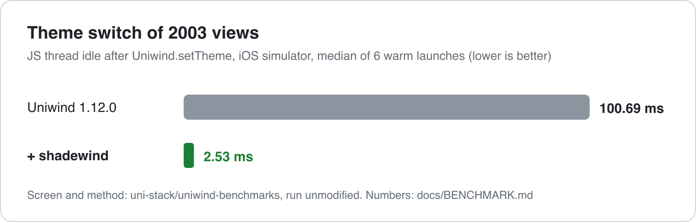
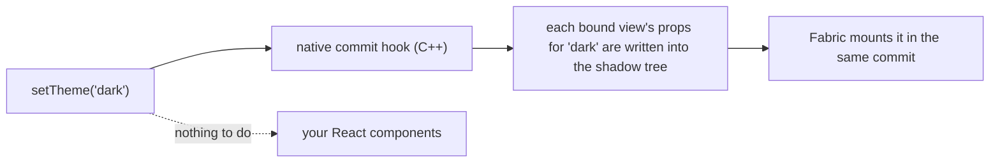

<div align="center">

# 🌗 shadewind

React Native 0.86 · New Architecture (Fabric) · iOS & Android · MIT · experimental

<p>
  <a href="docs/GUIDE.md">Guide</a> ·
  <a href="docs/BENCHMARK.md">Benchmark</a> ·
  <a href="docs/DEMO.md">Run the demo</a> ·
  <a href="docs/KNOWN_LIMITS.md">Known limits</a> ·
  <a href="docs/OVERVIEW.md">Architecture</a> ·
  <a href="docs/API.md">API</a>
</p>

</div>




Measured with the example from [`uniwind-benchmarks`](https://github.com/uni-stack/uniwind-benchmarks), thank you to the Uniwind team
for publishing it. The example is unmodified apart from the setup in the [quick start](#-quick-start-with-uniwind). This is JS-thread
time on one iOS simulator, not a frame-accurate measure and not a device; how it was run and what it does not show is in
[docs/BENCHMARK.md](docs/BENCHMARK.md). Want to try it yourself? [Run the 2003-view demo](docs/DEMO.md).

> 💚 **A note from the author.** I'm not a React Native internals expert. shadewind is vibe-coded with Claude Code by a developer who
> cares about the craft and enjoys programming. Please take the code and numbers with a pinch of salt, and tell me kindly where I
> went wrong. Thank you!

> **Status: experimental (0.x).** New Architecture only, React Native 0.86. iOS is the primary target; Android has less testing
> (one emulator, no physical device). Uniwind support is verified against Uniwind 1.12.x.

## ✨ What you get

- ⚡ **No re-render on a theme switch.** The new theme is applied to views that are already mounted, so your components stay put and
  the JS thread stays free.
- 🎨 **Works with your Uniwind `className`s.** They stay exactly as they are. The setup is two small changes (below).
- 🌗 **Optional animated switch.** `setTheme('dark', { transition: { type: 'fade', durationMs: 250 } })` cross-fades; instant by default.
- 🛠️ **See what the engine does.** A dev-only diagnostics log shows every view it binds and every commit it themes.
- 🧪 **Tested at the native level.** A harness runs React Native's real C++ renderer, so the commit logic is checked without a device.

## 🔧 How it works



Instead of asking every styled component to render again, shadewind remembers each view's props per theme and rewrites them
inside React Native's own shadow tree commit.

## 🚀 Quick start (with Uniwind)

```sh
npm install shadewind react-native-nitro-modules@^0.37.1
cd ios && pod install
```

shadewind is a [Nitro module](https://nitro.margelo.com): it needs `react-native-nitro-modules` 0.37.1 or newer in the 0.37 line
(the version it is built and tested with).

```diff
 // metro.config.js
 const { withUniwindConfig } = require('uniwind/metro');
+const { withShadewind } = require('shadewind/metro');

-module.exports = withUniwindConfig(config, { cssEntryFile: './global.css' });
+module.exports = withShadewind(withUniwindConfig(config, { cssEntryFile: './global.css' }));
```

```js
// index.js, after your app import
import { installUniwind } from 'shadewind/uniwind';

installUniwind();
```

That's it: your `className` code does not change. No Uniwind? shadewind also works on plain React Native, see the [guide](docs/GUIDE.md).

## 🎬 Demo

<div align="center">


</div>

The Account screen of the example app flipping between light and dark.

## 🤝 Contributing

- [Development workflow](CONTRIBUTING.md#development-workflow)
- [Code of conduct](CODE_OF_CONDUCT.md)

## 📄 License

MIT
