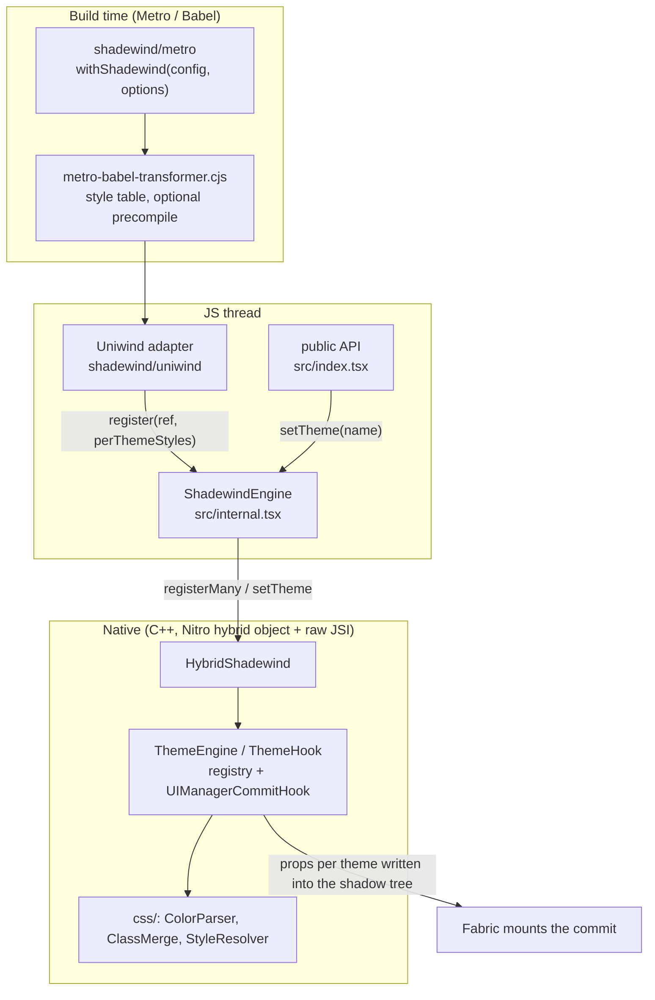

# Architecture

How shadewind is put together today. This page describes the code in this repository; it states no performance numbers (they are dated
and per protocol in [BENCHMARK.md](BENCHMARK.md)) and marks what is designed but not built. Back to the [README](../README.md) or the
[docs index](README.md).

## The idea

A theme switch normally makes every styled component render again. Shadewind keeps, for each styled native view, the props it has in
**every** theme, and applies the right set inside React Native's own shadow tree commit, from C++. The components stay as they are;
nothing re-renders for the switch.

## Layers

| Layer | What it does | Where |
|---|---|---|
| Build | Swaps Uniwind's `View` / `Text` / `Pressable` / `TouchableOpacity` / `withUniwind` for the engine-aware versions, prebuilds the native class table, optionally compiles literal `className`s | `metro.cjs`, `metro-babel-transformer.cjs`, `metro-precompile-plugin.cjs`, `metro-color-cache.cjs` |
| Public API | `configure`, `setTheme`, `getTheme`, `useTheme`, `useThemed`, `useThemedProps`, `ThemedView`, `ThemedText`, `cn`, transitions, diagnostics | `src/index.tsx`, `src/diagnostics.ts`, [API.md](API.md) |
| Engine client (JS) | Batches registrations, owns the native handle, picks the theme strategy | `src/internal.tsx` |
| Uniwind adapter (JS) | Decides per component whether the engine paints it, resolves a `className` per theme, renders the host element | `src/uniwind/` |
| Native engine (C++) | The registry (shadow-node family to per-theme props) and the commit hook that applies a theme | `cpp/ThemeEngine.hpp`, `cpp/ThemeHook.hpp`, `cpp/HybridShadewind.*` |
| Platform glue | The animated switch overlay, the Android commit worker | `ios/ShadewindNative.mm`, `android/src/main/`, `cpp/ShadewindNative.*`, `cpp/CommitWorker.hpp`, `cpp/ThemeTransition.hpp` |

## Build time: `shadewind/metro`

`withShadewind(withUniwindConfig(config, ...), options)` must be the outermost wrapper, so it sees the files Uniwind's resolver chose.
Nothing in `node_modules` is patched.

- **Component swap.** Uniwind's component files are replaced by `shadewind/uniwind/<name>` through the Metro resolver.
- **Prebuilt style table** (default on): `metro-babel-transformer.cjs` wraps the project's own Babel transformer and builds the native
  class resolver's table while bundling, so the first screen resolves natively. `prebuildStyleTable: false` builds it on the device
  when idle instead.
- **`cacheColors: true`** (off): a bounded cache in front of React Native's colour parser, for `StyleSheet` apps that write string
  colours.
- **`precompileClassNames: true`** (off, experimental): a Babel plugin rewrites `View` / `Text` that carry a `className` into
  hookless components. See [PRECOMPILE.md](PRECOMPILE.md).

## JS runtime

### Engine client (`src/internal.tsx`)

`ShadewindEngine` is the only thing that talks to the native object (`NitroModules.createHybridObject('Shadewind')`, created on first
use because component modules can be evaluated before the native runtime exists).

- `register(ref, themedStyles, renderTheme?, force?)` queues a view; the queue is flushed in one microtask as a single native
  `registerMany`. `unregister(ref)` drops a binding. A view already registered with the same styles object is not registered again
  unless `force` is set (a view React re-rendered under another theme, whose props the engine must read again).
- `setTheme(name, strategy, transition)` flushes pending registrations, then calls native.
- Strategies (`ThemeStrategy`): `hookAsync` (default: the commit runs on a background thread; on Android a single worker), `hook`
  (synchronous on the JS thread), `hookDeferred` (no commit of its own, the next commit carries the theme).

### Uniwind adapter (`src/uniwind/`)

- `install.ts` is the only file that reads Uniwind's runtime (`UniwindStore`, `UniwindListener`), lazily and inside `try/catch`. It
  checks the Uniwind minor version (tested: 1.12). When Uniwind is missing or unsupported the adapter reports inactive and every
  component behaves as plain Uniwind.
- `useShadewindStyle.ts` is Uniwind's `useStyle` plus a **plan** per className: resolve the style in every theme; if the themes differ
  only in `backgroundColor`, `borderColor` and `color`, hand the view to the engine (it is registered, and the adapter does not
  subscribe it to the theme). Otherwise the plan returns no per-theme styles and the view is not registered (see "Not painted by the
  engine" below). Decisions are cached per className and context and are visible in the dev diagnostics.
- `View.tsx`, `Text.tsx`, `Pressable.tsx`, `LightPressable.tsx`, `TouchableOpacity.tsx`, `withUniwind.tsx` are the replacements the
  build swaps in. `native.ts` is the direct path: a plain `View` or `Text` (none of the props React Native's own components rewrite)
  renders the host component directly, skipping their wrapper fibers.
- `styleCache.ts` replaces Uniwind 1.12's `getStyles` on the store instance with a bounded cache and one invalidation listener per dependency (see
  [KNOWN_LIMITS.md](KNOWN_LIMITS.md#memory)); `useShadewindStyle.ts` probes other themes without caching (`resolveUncached`) and shares one `themed` object per
  distinct set of colours.
- `nativeResolver.ts` and `styleTable.ts` load Uniwind's per-theme class table into C++ so a `className` can be resolved natively.
- `precompiled.tsx` is the runtime of `precompileClassNames`.

## Native engine (`cpp/`)

- **`HybridShadewind`**: the Nitro hybrid object. Typed methods come from the generated spec (`src/Shadewind.nitro.ts`, `nitrogen/`);
  the methods that need the JS runtime (`register`, `registerMany`, `setTheme`, `resolveClasses`, ...) are raw JSI.
- **`ThemeEngine.hpp`**: registration and theme state without JSI, so the native harness drives the same code against React
  Native's renderer.
- **`ThemeHook.hpp`**: a `UIManagerCommitHook`. `shadowTreeWillCommit` walks the new tree, and for each node whose family is
  registered it writes the props of the current theme into the node. Text is recoloured without a layout pass. Subtrees already
  themed by the previous commit and `display: none` subtrees are skipped. Up to 6 themes (`kMaxThemes`).
- **`css/`**: `ColorParser` (CSS colours to the ARGB value React Native expects), `ClassMerge` (the native `cn`, a
  `tailwind-merge`-compatible merge driven by a generated table), `StyleResolver` (Uniwind class resolution from the per-theme table).
  `ResolveGlue.hpp` is the JSI side of the resolver.
- **`CommitWorker.hpp`**: the Android thread `hookAsync` commits on; it knows nothing about React Native or the JVM.
- **`ThemeTransition.hpp`** with `ShadewindNative.*` / `ios/ShadewindNative.mm` / `android/src/main/java`: the animated switch. The
  overlay is native; the shared part decides when the new theme is on screen from the mounted tree's theme epoch.
- **`Diagnostics.hpp`**, **`DevTools.hpp`**: compiled in only for Debug (`SHADEWIND_DIAGNOSTICS`, `SHADEWIND_DEV_TOOLS`); a release
  build has no recorder, no `inspect()` and no timers in the hook. A release build used for measuring opts in
  (`SHADEWIND_DEV_TOOLS=1` at `pod install`, `shadewindDevTools=true` on Android).

## Flows

**Mount.** A styled component renders; the adapter resolves its style in every theme and hands the view a ref. When React attaches
the ref, `ShadewindEngine.register` queues `(shadow node, per-theme props)`. The microtask flush sends the whole batch to
`registerMany`, which stores each entry against the node's `ShadowNodeFamily`. A view always renders correctly for the theme it
mounted with; the registration is what makes later switches free.

**Theme switch.** `setTheme('dark')` flushes registrations and calls native. The hook's next commit (its own, or React's, depending on
the strategy) rewrites every registered node in the tree with the `dark` props, and Fabric mounts it in the same commit. No component
renders. Because the hook applies the theme on every later commit too, React cannot revert it.

**A React commit after a switch.** React re-renders a view with props of the theme it rendered under. The hook applies the current
theme again on that commit. A view React re-rendered under another theme calls its ref again and is registered anew (`force`), so the
engine rebuilds its per-theme props from React's.

**Unmount, hide, freeze.** An unmount takes the entry with it (entries hold weak references). A hidden or frozen screen keeps its
bindings; the hook themes it in the commit that shows it.

**Not painted by the engine.** The plan returns no per-theme styles, and the view is not registered, when the className has a scoped
theme, data attributes, an inline `style` that overlaps a painted key, themes that differ in properties other than the three painted
ones, a key missing in a theme, or while a pressable view is pressed or focused. Such a view renders with the style of the theme it
rendered under. Where that would leave it stale (data attributes, an inline style over a painted key, an unpainted property, a key missing
in a theme: `needsThemeRerender` in `useShadewindStyle.ts`) the adapter keeps the Theme dependency in its subscription, so a switch
re-renders it as plain Uniwind does; for a view the engine paints it drops the Theme dependency. A pixel comparison against plain Uniwind
(`example-real/scripts/edge-cases.py`) checks this. When the engine is inactive every component re-renders on a switch like Uniwind's own.

## Invariants

1. No React state or subscription on the theme-apply path (`useTheme()` / `subscribe()` are an opt-in for UI the engine does not own).
2. A view renders correctly at mount; an unregistered view is stale after a switch (a dev warning says so).
3. JS never sits on the switch path: `setTheme` is a native call.
4. Every theme defines every key a view registers.
5. The registry and the commit hook know nothing about Tailwind or Uniwind. Uniwind's runtime store is read in one file (`src/uniwind/install.ts`); the components also import a few Uniwind helpers (`uniwind-internal/...`), which Metro resolves inside the app.

## How it is tested

- **Native harness** (`cpp/harness`): runs React Native's real C++ renderer without a device (the hook, frozen screens, the Android
  `rawProps` mapping, the commit worker under sanitizers, the resolver and class merge against fixtures, and benchmarks).
- **JS checks** (`tools/*.cjs`): the adapter and the precompile plugin and runtime against Uniwind's real store.
- **Apps**: `example/` (the benchmark screen) and `example-real/` (a multi-screen app with the benchmark and diagnostics screens);
  [LOCAL_TESTING.md](LOCAL_TESTING.md) is the procedure.

## Repository map

| Path | Contents |
|---|---|
| `src/` | public API (`index.tsx`), engine client (`internal.tsx`), diagnostics, Nitro spec, `uniwind/` adapter |
| `cpp/` | engine, hook, worker, transition, `css/`, diagnostics, `harness/` (native tests), `experiments/` |
| `ios/`, `android/` | platform glue, podspec / CMake / Gradle |
| `metro.cjs`, `metro-*.cjs` | the Metro wrapper and Babel transformer and plugin |
| `bin/`, `tools/` | `shadewind-cn-table` CLI, JS checks |
| `example/`, `example-real/` | demo apps |
| `docs/` | this documentation; `design/` and `archive/` are history |

## Designed, not built

- An **own Tailwind compiler** (scan, compile, lower to a binary table) replacing the Uniwind bridge: the build chain was measured on
  a real app and the compiler was not written. See [the archived pipeline design](archive/RENDER_PIPELINE_DESIGN.md).
- An **AOT `className` resolver** for static sites. `precompileClassNames` covers part of that ground at run time.
- A SIMD family index (`cpp/experiments`), not wired in.
