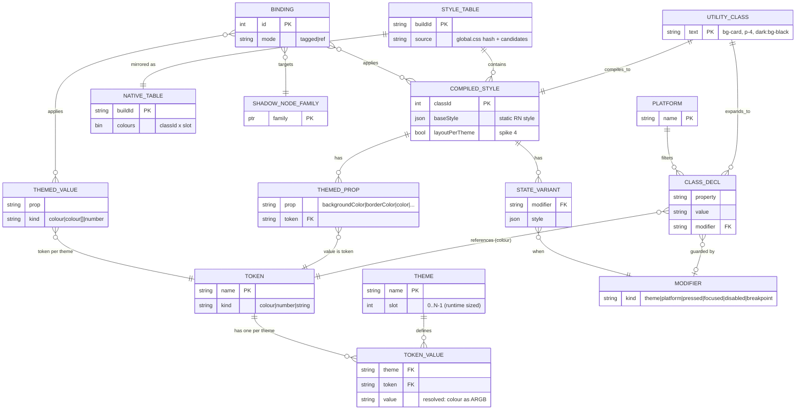
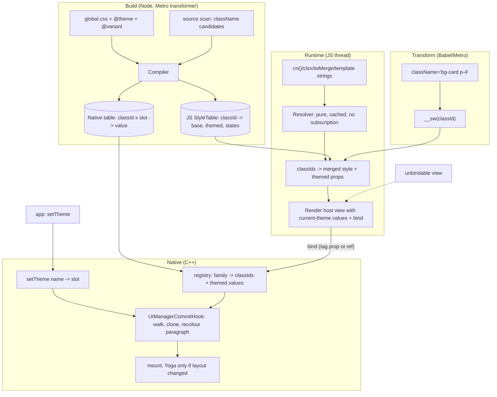

# Shadewind render pipeline: architecture and ERD (own Tailwind compiler)

Status: design, not implemented. Decision (2026-10-14): Shadewind no longer sits on top of Uniwind; it owns the style
pipeline. The Opus memo (docs/STRATEGY.md) advised against building a compiler; that evidence is kept here as *requirements*.

## 1. Requirements taken from the evidence

| Evidence (tovtam, iOS sim, Release, single runs) | Requirement |
|---|---|
| JS-value consumers (navigation theme, gradient `colors`, RichText `useUniwind`) dominate what is left after covering host views. Ablation (indicative, one run): median longest stall 60 ms -> 36 ms | every themed value needs a native route, not only `style` |
| 215 `className={...}`, 113 `cn(`, 28 `clsx`, 2 `twMerge` | dynamic class strings are the normal case: a pure, cached runtime resolver is mandatory |
| 21 `active:` classes | interaction state needs a design (open spike) |
| Stale frames returning to a frozen tab with plain Uniwind (~0.3 s), none with the engine | the commit hook stays the single place themes are applied |
| Uniwind private imports, Expo/Metro changes, React Compiler | no dependency on another library's internals |

## 2. Hard rules

1. **No React state or subscriptions on a theme path.** A theme change never calls `setState`, never notifies a React listener.
2. **Every themed value has a native route** (style keys, non-style props, navigation chrome).
3. **A view that cannot be bound still renders correctly** (the current theme's value is in its first render; it may be stale
   after a later switch only if the user opted out, never silently wrong at mount).
4. **JS never sits on the switch path**: `setTheme` is a native call; React is not asked to render.
5. **Compatibility goal**: tovtam's existing `global.css` (`@variant light/dark`, `@theme`) and `className` strings compile
   unchanged. Migration = config swap, not a rewrite. (Promise is conditional on the spikes in section 6.)

## 3. ERD

Reading: a **utility class** compiles to one **compiled style** (static base style + themed props that point at **tokens** +
state variants). Tokens have one value per **theme**. A **binding** ties a shadow-node family to compiled styles and to
**themed values** (non-style props). The native table holds `classId x slot -> value` so the commit hook never calls JS.

## 4. Pipeline

| Stage | Input | Output | Owner / thread |
|---|---|---|---|
| Build: compile | global.css, candidates | JS StyleTable + native table | Node, build time |
| Transform | literal `className` | class id call | Babel/Metro, build time |
| Resolve | class string(s) | merged style + themed props | JS, render, pure function with a cache keyed by the string |
| Bind | host ref or tag prop | family -> ids in registry | JS render -> C++ registry (mutex) |
| Switch | `setTheme(name)` | slot id, epoch++ | JS call -> C++, returns immediately |
| Apply | commit | cloned nodes with theme values | C++ commit hook (JS thread sync, or background) |
| Interaction state | press/focus/disabled | state variant applied | open spike 3 |
| Fallback | class not in table / unbindable | plain unthemed style + dev warning | JS |

## 5. Reuse and retire

- **Keep**: commit hook, paragraph recolour, Android `rawProps`, `configure`, per-theme slots, `useThemed`, `useThemedProps`,
  shared process-lifetime state.
- **New**: compiler (Tailwind v4 candidates + CSS theme blocks), StyleTable, runtime resolver, native table, node tagging
  (if spike 1 passes).
- **Uniwind seam** (`metro.cjs`, `src/uniwind`): decision needed. Recommended: keep as a *deprecated migration bridge* for one
  release (apps can adopt the engine before the compiler exists), then delete. Not extended further.

## 6. Open decisions: each needs a spike with a pass criterion (not answered from memory)

| Spike | Question | Pass criterion |
|---|---|---|
| 1 Node tagging | does a `themeClassId` prop reach C++ props or does the view config drop it? | lands in C++ props -> no private `getNodeFromInternalInstanceHandle` binding; dropped -> keep ref binding |
| 2 Third-party props | does `cloneProps` on raw props repaint `expo-linear-gradient` `colors`? | colours repaint without a React render; `useThemedProps` depends on this and is untested |
| 3 Interaction state | `active:`/`focus:`/`disabled:` (21 `active:` in tovtam) without React state | a native route exists; else a documented scoped exception to rule 1 |
| 4 Per-theme layout | `dark:p-8` | supported (dirty Yoga in the hook) or explicitly out of scope; pick one |
| 5 Slot count | `kMaxThemes = 6` fixed array | slots sized at runtime from `configure` |
| 6 Build pipeline | Tailwind v4 candidate extraction inside Metro/Expo + React Compiler + web | compiles tovtam's `global.css` and sources with no changes |

## 7. Housekeeping

- `useThemedProps` and `toNativePropsWith` are committed on this branch.
- The tovtam copy (`scratchpad/tovtam`) still has **ablation edits** in `useThemeConfig`, `useGradientColors` and `RichText`
  (originals in `/private/tmp/claude-501/*.orig.*`); it is **not a clean baseline**. Its numbers: plain 64.8 ms, engine 60.3 /
  59 ms, engine + ablation 36.1 ms median longest stall (single or two runs, indicative).
