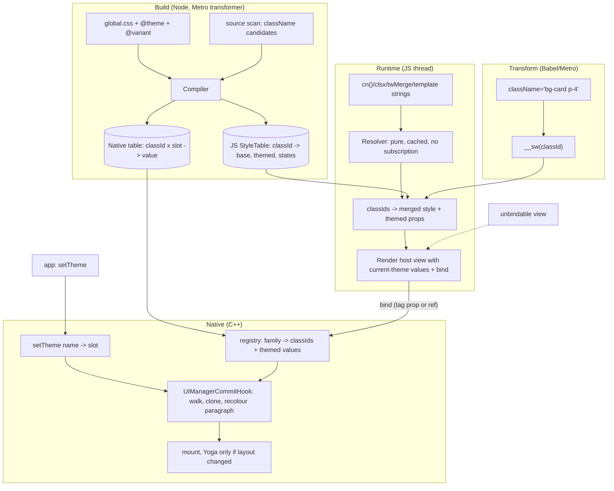

# Shadewind render pipeline: architecture and ERD (own Tailwind compiler)

Status: design, not implemented. Decision (2026-10-14): Shadewind no longer sits on top of Uniwind; it owns the style
pipeline. The Opus memo (docs/STRATEGY.md) advised against building a compiler; that evidence is kept here as *requirements*.

## 1. Requirements taken from the evidence

| Evidence (tovtam, iOS sim, Release, single runs) | Requirement |
|---|---|
| JS-value consumers (navigation theme, gradient `colors`, RichText `useUniwind`) dominate what is left after covering host views. Ablation (indicative, one run): median longest stall 60 ms -> 36 ms | every themed value needs a native route, not only `style` |
| 215 `className={...}`, 113 `cn(`, 28 `clsx`, 2 `twMerge` | dynamic class strings are the normal case: a pure, cached runtime resolver is mandatory |
| 21 `active:` classes | interaction state needs a design (open spike) |
| Stale frames returning to a frozen tab with plain Uniwind (~0.3 s), none with the engine | the commit hook stays the single place themes are applied |
| Uniwind private imports, Expo/Metro changes, React Compiler | no dependency on another library's internals |

## 2. Hard rules

1. **No React state or subscriptions on the theme-apply path.** `setTheme` never calls `setState` and never notifies a React
   listener to re-render styled views. *Scoped exception:* `useTheme()` / `subscribe()` (a `useSyncExternalStore` read) exist for
   UI the engine does not own (status bar, a text label showing the theme name). They are opt-in, never used by the compiler's
   output, and the old `useThemed` fallback subscription is **dropped**.
2. **Every themed value has a native route**: style keys (hook), non-style props (`useThemedProps`), paragraph colour (state
   rebuild). *Navigation chrome* is **not** claimed here: react-navigation's theme is a JS context object with no engine path.
   Mechanism: keep the theme object identity stable and theme chrome through bound host views and native tab/header props via
   `useThemedProps`; anything that cannot be done this way is out of scope until a spike says otherwise (spike 7).
3. **A view always renders correctly at mount** (its first render uses the current theme's resolved value). *After a later switch*
   an unbound view is **stale, with a dev warning**: there is no subscription to fix it (rule 1). The guarantee that this
   never happens in practice depends on spike 1 (every host view bindable); until it passes, binding is by ref and views that
   hide their ref (custom components that do not forward it) are the stale case.
4. **JS never sits on the switch path**: `setTheme` is a native call; React is not asked to render.
5. **Compatibility goal**: tovtam's existing `global.css` (`@variant light/dark`, `@theme`) and `className` strings compile
   unchanged. Migration = config swap, not a rewrite. (Conditional on the spikes in section 6.)

## 2b. Who merges (single source of truth)

- **Merging is JS**: `cn()` / `clsx` / `twMerge` / template strings are resolved by the runtime resolver in JS, with Tailwind
  conflict rules, producing one merged style + the themed props per theme.
- A **binding carries per-theme deltas** (today's `register` path: `{ theme -> props }`). The commit hook applies those.
- The **native `classId x slot` table is only an optimisation** and only exists if spike 1 (node tagging) passes: then a
  literal class id can be read natively without a JS merge. It never merges; dynamic strings always go through the JS resolver.
- Unknown pieces: a dynamic string built from known utilities (`cn('bg-card', cond && 'border-primary')`) resolves from the
  token table at runtime. Only a truly unknown utility falls back (unthemed style + dev warning).

## 3. ERD


Reading: a **utility class** compiles to one **compiled style** (static base style + themed props that point at **tokens** +
state variants). Tokens have one value per **theme**. A **binding** ties a shadow-node family to compiled styles and to
**themed values** (non-style props). The native table holds `classId x slot -> value` so the commit hook never calls JS.

## 4. Pipeline



| Stage | Input | Output | Owner / thread |
|---|---|---|---|
| Build: compile | global.css, candidates | JS StyleTable + native table | Node, build time |
| Transform | literal `className` | class id call | Babel/Metro, build time |
| Resolve | class string(s) | merged style + themed props | JS, render, pure function with a cache keyed by the string |
| Bind | host ref or tag prop | family -> ids in registry | JS render -> C++ registry (mutex) |
| Switch | `setTheme(name)` | slot id, epoch++ | JS call -> C++, returns immediately |
| Apply | commit | cloned nodes with theme values | C++ commit hook (JS thread sync, or background) |
| Interaction state | press/focus/disabled | state variant applied | open spike 3 |
| Fallback | truly unknown utility, or unbindable host | current-theme value at mount, stale after a switch, dev warning (rule 3) | JS |

## 5. Reuse and retire

- **Keep**: commit hook, paragraph recolour, Android `rawProps`, `configure`, per-theme slots, `useThemed`, `useThemedProps`,
  shared process-lifetime state.
- **New**: compiler (Tailwind v4 candidates + CSS theme blocks), StyleTable, runtime resolver, native table, node tagging
  (if spike 1 passes).
- **Uniwind seam** (`metro.cjs`, `src/uniwind`): **open question for the owner.** You said you no longer want to run on top of
  Uniwind. Default in this doc: retire it (delete) once the compiler can compile tovtam. The alternative is a deprecated bridge
  for one release. Not extended further either way.

## 6. Open decisions: each needs a spike with a pass criterion (not answered from memory)

| Spike | Question | Pass criterion |
|---|---|---|
| 1 Node tagging | does a `themeClassId` prop reach C++ props or does the view config drop it? | lands in C++ props -> no private `getNodeFromInternalInstanceHandle` binding; dropped -> keep ref binding |
| 2 Third-party props | does `cloneProps` on raw props repaint `expo-linear-gradient` `colors`? | colours repaint without a React render; `useThemedProps` depends on this and is untested |
| 3 Interaction state | `active:`/`focus:`/`disabled:` (21 `active:` in tovtam) without React state | a native route exists; else a documented scoped exception to rule 1 |
| 4 Per-theme layout | `dark:p-8` | supported (dirty Yoga in the hook) or explicitly out of scope; pick one |
| 5 Slot count | `kMaxThemes = 6` fixed array | slots sized at runtime from `configure` |
| 7 Navigation chrome | can react-navigation's theme be driven natively (stable theme object + bound chrome + `useThemedProps`)? | header and tab bar repaint on a switch with no `NavigationContainer` re-render, or documented out of scope |
| 6 Build pipeline | Tailwind v4 candidate extraction inside Metro/Expo + React Compiler + web | compiles tovtam's `global.css` and sources with no changes |

## 7. Housekeeping

- `useThemedProps` and `toNativePropsWith` are committed on this branch.
- The tovtam copy (`scratchpad/tovtam`) still has **ablation edits** in `useThemeConfig`, `useGradientColors` and `RichText`
  (originals in `/private/tmp/claude-501/*.orig.*`); it is **not a clean baseline**. Its numbers: plain 64.8 ms, engine 60.3 /
  59 ms, engine + ablation 36.1 ms median longest stall (single or two runs, indicative).

## 8. Build toolchain (validated by Opus, 2026-10-14)

Nothing in 2026 is meaningfully faster or better suited than Lightning CSS for "parse + typed values + Node visitor", and CSS
parsing is not the bottleneck (small `global.css`; the cost is candidate scanning).

Corrections to the first answer: Tailwind v4's `compile` does **not** use Lightning CSS (own JS parser and AST); only
`@tailwindcss/node`'s `optimize()` does, with LightDark excluded. Vite 8 (not Rolldown) uses Lightning CSS as its default
minifier. `oxc-css-parser` exists but has no Node binding or visitor API. Uniwind's own dependencies are
`@tailwindcss/node`, `@tailwindcss/oxide`, `lightningcss`, `culori`: a proven stack.

Pipeline:

1. `@tailwindcss/oxide` `new Scanner({ sources })`, `.scan()` (incremental `.scanFiles(changed)` in the Metro transformer).
2. `@tailwindcss/node` `compile(globalCss, { base, onDependency })`, then `.build(candidates)` for the raw CSS. Skip `optimize()`
   (it applies targets and rewrites the input).
3. `lightningcss.transform({ code, visitor, customAtRules: { variant: ... } })` with **no `targets`** (otherwise `light-dark()` is
   lowered to `--lightningcss-light/dark` variables). Walk `layer-block`, `style`, `custom` and `light-dark` nodes into the
   per-theme tables.
4. `culori` to normalise oklch and other colours into RN-ready values.
5. Cache by hash of `global.css` + Tailwind version + sorted candidates; invalidate through `onDependency`.

API surface verified in the 4.3.3 / 1.33.0 typings: `tailwindcss` `compile`/`compileAst`/`__unstable__loadDesignSystem`
(`candidatesToCss`, `candidatesToAst`); Lightning CSS `Declaration.custom`, `CssColor` `light-dark`, `Rule.custom`,
`Rule.unknown`, `customAtRules`, `composeVisitors`.

## 9. Pipeline v2 (updated 2026-10-14)

### Spike 6 result (build chain on tovtam, run once, cold, `spikes/compiler-spike`)

| Step | Result |
|---|---|
| Oxide `Scanner` over `src/**` | 13,437 candidates in 48.8 ms |
| `@tailwindcss/node` `compile(global.css)` + `build(candidates)` | 48.1 ms, 45 KB CSS, 246 custom properties, 557 rules |
| Lightning CSS visitor over that CSS | 5.6 ms to walk it and extract tokens |
| Per-theme tokens found | **superseded, see section 11**: the first extractor was wrong (light map held dark values) |
| Colour path | **superseded, see section 11**: with no `targets` Lightning CSS keeps `oklch`; `culori` converts every token |

Findings that change the design:

- The theme blocks come out as `:root:where(.light, .light *) { --color-...: ... }`. Extraction = match selectors of that shape
  and read the custom properties; the theme name is the class.
- `@variant light/dark` is **not** a Tailwind built-in: `global.css` gets it from `@import "uniwind"` (`uniwind.css` defines the
  `@custom-variant`s and `@utility`s such as `m-safe`). Our compiler therefore ships its own small preset CSS (theme variants,
  platform variants `ios`/`android`/`native`, safe-area utilities) so `global.css` keeps working with `@import "shadewind"`
  instead of `@import "uniwind"` (the one-line config swap).
- `--color-*: unset` placeholders appear from `@theme`; they are defaults, not values.
- Whole build about 100 ms cold for a 13k-candidate app; not a bottleneck, caching by content hash is enough.

### Updated stage list

| # | Stage | Input -> output | Owner | Change from v1 |
|---|---|---|---|---|
| 1 | Scan | sources -> candidates | Rust (oxide) via Node | unchanged, measured |
| 2 | Compile | `global.css` + preset + candidates -> CSS | `@tailwindcss/node` | new preset replaces `@import "uniwind"` |
| 3 | Lower | CSS -> theme token maps + class declarations | Lightning CSS visitor (no `targets`) | measured 5.6 ms |
| 4 | Colour | oklch/color-mix -> ARGB `uint32` | Lightning CSS first, `culori` for what it does not lower | unchanged |
| 5 | Emit | -> **binary** native table (`classId x slot`, `uint32` ARGB, token dictionary) + small JS module (classIds, base styles) | Node | **new: no JSON/strings parsed at runtime** |
| 6 | Load | binary table -> native memory | C++ at startup (mmap/memcpy) | **new** |
| 7 | Bind | JS passes packed ids (ints / `Int32Array`), not objects | JSI | **new: no per-view `folly::dynamic` conversion** |
| 8 | Index | `family -> binding` | C++ flat SIMD index (`cpp/experiments/FamilyIndex.hpp`) | **new**, 2-4x per lookup on big trees |
| 9 | Walk | commit -> changed subtrees only (pointer diff vs previous root, skip non-React/non-self commit sources) | C++ hook | **new** (RENDER_CORE.md rank 2) |
| 10 | Apply | slot -> cloned props; iOS option: custom-trait dynamic colours (no commit) | C++ / UIKit | iOS spike 3 |

### Pipeline (v2)

```mermaid
flowchart LR
  subgraph B["build (Node, Rust libs)"]
    A1[sources] --> S1[oxide Scanner]
    G[global.css + shadewind preset] --> C1["tailwindcss compile().build()"]
    S1 --> C1 --> L1[lightningcss visitor, no targets]
    L1 --> K1[culori for leftovers]
    K1 --> E1[emit]
  end
  E1 --> BIN[(binary table: classId x slot -> ARGB)]
  E1 --> JSM[(JS module: classIds, base styles)]
  subgraph R["runtime"]
    JSM --> RES[resolver cn/clsx/twMerge, pure + cached]
    RES -->|packed ids| BIND[bind(ref)]
    BIN -->|mmap| REG[C++ registry: SIMD family index]
    BIND --> REG
    SW[setTheme] --> HOOK[commit hook: pointer-diff walk]
    REG --> HOOK --> CLONE[clone + paragraph recolour] --> MOUNT[mount]
    SW -.iOS only.-> TRAIT[window.traitOverrides: dynamic UIColor]
  end
```

### Not in this pipeline (decided)

- A Rust runtime core (no Nitro Rust target, FFI per node, <= 5 % of a ~3 ms commit).
- Anything that parses JSON or colour strings on the JS thread at runtime.

## 10. AOT resolver (design, 2026-10-14)

Goal: the runtime resolver does table lookups on integers, never parses class strings, never runs tailwind-merge.

### What tovtam actually contains (1,769 `className=` sites, counted by a script over `src/`)

| Form | Sites | Share | AOT treatment |
|---|---|---|---|
| `className="a b c"` literal | 1,554 | 87.8 % | compile-time class id, hoisted constant |
| `className={"a b"}` | 76 | 4.3 % | same |
| `` className={`a b`} `` (no `${}`) | 1 | 0.1 % | same |
| `cn("a", "b")` all literals | 4 | 0.2 % | same, merged at build |
| `cn("a", cond && "b", className)` | 79 | 4.5 % | segment ids + variant table / id merge |
| `cn("a", className)` (identifier) | 28 | 1.6 % | id + runtime id merge |
| identifier / prop | 12 | 0.7 % | runtime id-or-string path |
| ternary | 10 | 0.6 % | two precompiled ids, select at runtime |
| template with `${}` | 5 | 0.3 % | runtime path |

Fully static: **92.4 %**. Dynamic forms (about 7.6 %) are mostly literal segments plus one or two runtime inputs.

### Transform (Babel plugin / Metro transformer, runs before React Compiler)

```tsx
// in
<View className={cn("flex-row p-4", active && "bg-card", className)} />
// out (class table values are build-time facts)
const _a = __sw.s(12);            // "flex-row p-4"        -> hoisted frozen style + themed refs
const _b = __sw.s(31);            // "bg-card"
<View {...__sw.cn(_a, active ? _b : 0, className)} />   // className is a string or an id; ids are ints
```

1. **Literals** -> `__sw.s(id)`; the id indexes the generated table (base RN style, themed props as token refs, state variants).
2. **Known conflicts resolved at build**: for segments that are all literals the `twMerge` result is computed at build time.
   Between a literal and a runtime value, each class id carries a *property-group bitset* (which RN style props it sets), so
   the runtime merge is "last wins per group" over a small int array, not string parsing.
3. **Bounded variant tables**: for `cn("a", c1 && "b", c2 && "c")` with at most 3 independent boolean inputs, emit the
   `2^n` merged ids as a switch: zero runtime merge.
4. **Interning**: merged results are memoised by the id tuple and frozen, so React sees stable prop identity.
5. **Boundary**: a literal passed down as a `className` prop travels as a branded id (number); `cn` and the host-component
   adapter accept id or string. A string reaching the runtime is looked up in a prebuilt `Map<string, id>` (O(1)); only an
   unknown string is parsed (dev warning, unthemed fallback).
6. **Dev**: Fast Refresh keeps working because the table module is regenerated and the plugin only emits ids and a `__sw`
   import; in dev the string path is allowed everywhere.

### Why this is the right place to spend effort

- It removes per-render string work and allocation on the JS thread (what Uniwind's `useStyle` does per component today).
- It makes the binding payload a few ints, which is what the native table and the SIMD index want (section 9, stages 5-8).
- Risk: React Compiler ordering, third-party components that stringify `className`, and `twMerge` edge cases (arbitrary values,
  important modifiers). Spike 8 below proves it on tovtam's 1,769 sites.

### Spike 8: AOT transform on tovtam

Pass when: the plugin rewrites at least 90 % of `className` sites to ids (target 92.4 %), the app renders pixel-identical on
the screens already recorded, and the runtime resolver's per-render cost is under a measured threshold (single-digit
microseconds per component in a Release build) versus plain Uniwind's `useStyle`.


## 11. Parser pipeline review (Opus, 2026-10-14): corrections

The review re-ran the chain against `out.css` (1,951 lines; Tailwind 4.3.3; lightningcss 1.30.2). Verdict: **go on the chain
(oxide -> `@tailwindcss/node` -> lightningcss, no targets -> culori); no-go on the first `extract.mjs`; section 9's token and
colour claims were wrong and are superseded.**

| Sev | Defect | Fix |
|---|---|---|
| Critical | the "light" map held dark values: the regex took the first class name in the selector JSON, and the `@media (prefers-color-scheme: dark) :root:not(:where(.light...))` block names `light` first. 18 of 27 tokens were visibly wrong in light mode; "27 per theme" hid it | classify selectors on the AST; treat `:not(:where...)` blocks as *system twins* and assert they equal the explicit theme |
| Critical | section 9 said Lightning CSS lowers oklch to rgb: with no targets it stays `oklch`; the rgb sample was the dark brand (written as `rgb()` in `global.css`) leaking in; "culori agrees" converted a hard-coded literal | culori converts every token |
| High | ARGB packing had no clamp (out-of-gamut yellow packed to `ffffffb2`, correct `ffffd700`) and alpha was hard-coded | clamp each channel, pack real alpha |
| High | colour parity undefined: lightningcss lowering vs Uniwind (culori clamp + `formatHex`) max channel delta 3 (yellow); Uniwind's `colorMix` ignores `in oklab` (alpha-only for transparent mixes, sRGB interpolation otherwise) | match Uniwind, write the policy down, pixel-test |
| High | opacity variants carry broken fallbacks (`color-mix(in srgb, unset N%, transparent)`, `--tw-shadow-color: unset`); only the nested `@supports` branch is correct | walk `@supports` and nested rules, later declaration wins, fold per theme |
| Medium | non-colour and base tokens dropped (`:root, :host` has 58 custom properties: 37 non-colour, 20 `unset` placeholders) | base map that each theme overlays |
| Medium | partial themes (an `ocean` block with 1 token leaves 26 missing; CSS cascade falls through to the system twin) | require full themes or a declared base scheme; warn on missing tokens |
| Medium | scanner ignores `@source`; `onDependency` is a no-op, so imported-CSS edits never invalidate | scan `[...compiler.sources, {base: dirname(css)}]` like Uniwind; cache key = all dependency hashes + versions |
| Medium | scan scope: `src/**` 589 files / 13,437 candidates; project root 23,639 files / 259k candidates / 7.35 s because untracked `ddrel/` (Xcode DerivedData) is not ignored | scan root plus `@source`, ignore build dirs, warn on large counts |
| Low | lightningcss versions disagree (1.30.2 top, 1.30.1 inside Uniwind) and the folded AST value of `color-mix(in oklab, ...)` differs from lowering and culori | pin one version; do not trust folded AST colour values |

Facts to design against (verified in the review): all token blocks have equal specificity (0,1,0); the cascade key is
(layer rank, source order), not visitor order alone; token blocks are emitted after utilities but live in `@layer theme`;
with no `targets`, `light-dark()` stays `light-dark` in custom properties and declarations, and `@theme inline` puts it directly
into utilities (so utilities need the same resolver); `env()`, `max()`, `hairlineWidth()`, `@media ios/android` and `@container`
pass through raw and need runtime handling; Tailwind >= 4.3.3 flattens selectors to `[class, where(...)]`.

Three riskiest unknowns remaining: (1) matching Uniwind's colours exactly (clamp vs gamut mapping, sRGB vs oklab mixing, alpha
folding) without a pixel test; (2) themes beyond light/dark (partial themes, which scheme `light-dark` uses for `ocean`,
system-follow done at runtime instead of through CSS twins); (3) values that cannot be precomputed and Tailwind-output drift
across versions, plus cache invalidation.

Reviewed extractor output on tovtam: light `primary` `ff1a1a1a`, dark `ffe0e0e0`, yellow `ffffd700`, 28 colour tokens per theme,
37 non-colour base tokens, system twins equal to their themes, no issues.

## 12. Parser work moved to C++ (2026-10-14)

`cpp/css/ColorParser.hpp` parses CSS colours natively (`#rgb[a]`, `#rrggbb[aa]`, `rgb()`/`rgba()`, `hsl()`/`hsla()`, `oklch()`,
`transparent`, `white`, `black`; comma and `space / alpha` syntaxes; percentages). `HybridShadewind::registerNode` converts
colour strings (keys named `color`, `*Color`, `colors`) to unsigned ARGB before building typed deltas, so JS no longer calls
`processColor` for those values; unsupported values (named colours, `PlatformColor`, `DynamicColorIOS`) still use `processColor`.

Parity (`cpp/tests`, 3,209 generated cases vs `culori`, same clamp policy): 3,205 exact, 4 within one channel step, 0 worse,
0 parse failures (out-of-gamut `oklch` included). Example app, Release, iOS simulator, `hook`, 2003 views: median 2.38 ms,
treeOK / viewOK / layerOK 2002 / 2002 / 2002.

Stays out of C++ (decided): Tailwind compile and the Lightning CSS walk (JS/Rust at build time). Candidates next: binary token
table loader, `var()` / `light-dark()` resolver for runtime variable updates, `color-mix` folding.
