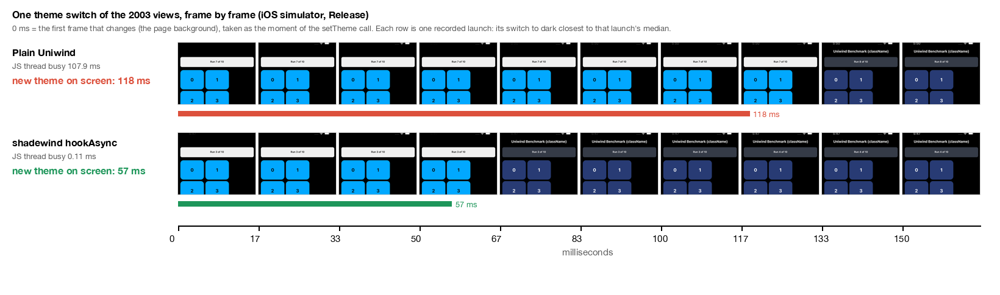

# Theme-change benchmark: this engine vs Uniwind

## End to end, uniwind-benchmarks render and theme (2026-10-19)

The repository's own protocol (`scripts/bench/measure.py`), unchanged: Release builds, iPhone 17 Pro simulator (iOS 26.5), StyleSheet
control launches before and after every block and a fresh StyleSheet baseline (`--rebaseline`), six warm launches per block, two
sweeps in alternating order, so twelve warm launches per build. All three builds in the same session per scenario; no block was
rejected; host load 3-6 during the runs (a theme run started during a load spike to 30 was discarded and run again).

**Render** (re-mount of the 2003-view list, time until the JS thread is idle, median of twelve):

| Build | Median | Spread | vs StyleSheet | Memory after GC |
|---|---|---|---|---|
| StyleSheet (baseline) | 38.94 ms | | 1.00x | ~93 MiB (controls) |
| Uniwind 1.12 | 64.31 ms | 59.99-65.57 | 1.65x | 138.1 MiB |
| Shadewind `d171749` | 57.48 ms | 55.56-60.68 | 1.48x | 125.2 MiB |
| Shadewind `0197c72` | **49.93 ms** | 48.32-51.81 | **1.28x** | 134.4 MiB (spread 111.8-135.9) |

Memory after GC follows the peak of the run, not what the app holds (freed malloc pages that iOS has not taken back count too; see
"Mount, engine only" below): the same `0197c72` build read 114.4 MiB in the earlier run the same day, and its spread here is 24 MiB.
Treat the memory column as noisy; no memory claim is made from it.

**Theme** (the list mounted once, ten light/dark switches, time per switch until the JS thread is idle, median of twelve):

| Build | Median | Spread |
|---|---|---|
| Uniwind 1.12 | 105.86 ms | 96.95-111.83 |
| Shadewind `d171749` | 2.61 ms | 2.50-2.89 |
| Shadewind `0197c72` | **2.45 ms** | 2.34-2.59 |

The theme number is the JS thread only: the main thread still applies the new colours after it, see "On screen, frame by frame"
below (about 57 ms to pixels with Shadewind, about 111 ms with plain Uniwind, earlier build). An earlier same-protocol render run on
the same day measured `d171749` at 55.44 ms and `0197c72` at 47.58 ms (StyleSheet 36.67 ms): the absolute numbers move between
sessions with the host, the ratios to StyleSheet stay close.

Instruments traces of both builds (Release, 20 re-mounts + 20 switches in one launch, converted to Perfetto timelines with the JS and
main threads) show the same split per re-mount in both: JS (React + adapter) about 40 ms, React Native `createNode` about 12 ms, Yoga
about 8 ms, GC about 7 ms, Shadewind `registerMany` about 1 ms (sampled at 1 ms with the profiler running, so larger than the
benchmark's own times). The traces are not part of the repository.

## Mount, engine only (2026-10-19, uniwind-benchmarks render scenario)

The `uniwind-benchmarks` render screen (2003 views, re-mounted 10 times per launch; the app reports the average time from the
re-mount until the JS thread is idle), its `apps/uniwind` app with `withShadewind` + `installUniwind()`, Release builds,
iPhone 17 Pro simulator (iOS 26.5). Runner: a small script on top of the repository's `scripts/bench/measure.py` (same install,
launch, screen read and memory reading) without the StyleSheet controls: per arm and sweep one cold launch (dropped) and three warm
launches, two sweeps in alternating order; the number is the median of the six warm launches. Memory is `phys_footprint` after one
simulated memory warning.

Same session, the build before this work against this version:

| Build | Mount (median) | Spread | Memory after GC |
|---|---|---|---|
| `d171749` | 55.19 ms | 54.25-55.61 | 124.9 MiB |
| this version | **47.92 ms** | 47.29-48.39 | 124.0 MiB |

-7.27 ms (-13 %). The three changes, each measured against the one before it (separate sessions, so the session baselines differ
by a few ms and the deltas do not add up exactly):

| Change | Before | After | Delta |
|---|---|---|---|
| Text: a numeric `fontWeight` (Uniwind resolves `font-bold` to 700) stays on the direct host path, as a string like Text.js; Text.js's default `overflow: hidden` added there | 59.06 ms | 52.41 ms | -6.65 ms |
| One shared Uniwind subscription per dependency list; adapter imports read once instead of Metro's inline `require` per render; constant Text state objects | 55.17 ms | 54.61 ms | -0.56 ms (within the spread) |
| Subscription from the view's ref instead of a layout effect (`withUniwind` keeps the effect: its component may ignore `ref`) | 50.73 ms | 48.66 ms | -2.07 ms |

Where the remaining time goes (one re-mount, Release estimate: the native parts from an Instruments trace of the Release build, the
JS parts from a Hermes sampling profile of the production bundle, 30 re-mounts in one launch; the Text-fix build):

| Part | ms |
|---|---|
| React (fibers and hooks 9.2, delete the previous tree 3.4, complete + commit + effects 3.5, other 1.4) | 17.5 |
| React Native (C++ `createNode` props parsing 7.6, Yoga 6.5, JS props payload 4.2, commit 1.5) | 19.8 |
| Hermes GC | 7.3 |
| Shadewind (adapter JS 5.1, `registerMany` 1.1) | 6.2 |

What is left for Shadewind, measured with throwaway builds that remove one per-view piece (they cannot switch themes; same session
as each other, against the build with the first two changes at 51.31 ms): without the per-view ref and registration 45.42 ms
(-5.89 ms, -31 MiB), without the layout effect 47.04 ms, without the reducer and the effect 45.39 ms; without all of them (another
session) 42.14 ms against 54.84 ms. Removing the ref means registering the views at theme-switch time instead of at mount
(docs/archive/HANDOFF.md); it is not done because a view whose className changes would keep its old binding until the next switch.

For scale: StyleSheet's own median on the same screen was 37.28 ms (measure.py, 2026-10-18); plain Uniwind 1.12 61.86 ms in the
owner's run (docs/archive/HANDOFF.md, another protocol). One simulator, not a device.

Correctness of this version: a theme switch, a className change on a bound view after a switch, and `Uniwind.updateCSSVariables` on the
benchmark screen each end with all 2007 views right (`inspect()`: tree, native props and layer) and nothing stale; the `example-real`
freeze sequences 1-3 of docs/LOCAL_TESTING.md step 4 (Release) end with `STALE` empty and `treeOK == inTree` on every screen. Not run:
sequence 4 (pressed card), a frame-by-frame recording of the reveals, the theme scenario, Android.

## On screen, frame by frame (2026-10-18, latest code)

The Uniwind `uniwind-benchmarks` theme screen (header card + 1000 items = 2003 views) in `example-real` with `-theirBench theme`,
Release build with dev tools on, iPhone 17 Pro simulator (iOS 26.5), code at `1a54fa6` plus a local `-mainProbe` option in
`example-real/src/bench/TheirBench.tsx` (not committed). Plain Uniwind is `bash scripts/arm.sh plain && REAL_PLAIN=1 ...`, the engine is
`bash scripts/arm.sh engine`; `hookAsync` is `-uniwindStrategy hookAsync`. For each row: one cold launch discarded, then six warm launches.

**JS thread busy** (the "JS idle avg" of each launch; the median of the six is the last column). It leaves out the main thread's mount,
and for `hookAsync` its background commit, so read it as JS time, not as switch time:

| Build / strategy | Six warm launches (ms) | Median | Result line |
|---|---|---|---|
| Plain Uniwind | 108.40, 107.95, 106.11, 102.74, 107.93, 108.95 | **107.94** | "no engine report (plain arm)" |
| `hookDeferred` | 2.81, 2.65, 3.10, 3.24, 3.00, 3.11 | **3.05** | `registered=treeOK=viewOK=layerOK=2003` |
| `hookAsync` | 0.10, 0.10, 0.12, 0.11, 0.11, 0.11 | **0.11** | `registered=treeOK=viewOK=layerOK=2003` |

**New theme on screen.** One screen recording per row (`xcrun simctl io booted recordVideo`, a variable-frame-rate video with about
8 ms timestamp resolution). In each switch the page background flips first, then the 2003 cells follow. 0 ms is the first changed frame,
which we take as the `setTheme` call (we did not observe the call itself; plain Uniwind's gap matching its JS time supports it, it does
not prove it). The gap is the time until the cells change, for each of the 10 switches of the recording:

| Row | Gap per switch (ms) | Median |
|---|---|---|
| Plain Uniwind | 108, 103, 112, 107, 127, 118, 118, 110, 123, 107 | **111** |
| `hookDeferred` | 67, 58, 57, 57, 57, 58, 55, 57, 58, 57 | **57** |
| `hookAsync` | 78, 60, 57, 53, 57, 57, 55, 60, 57, 57 | **57** |

What it shows:

- Plain Uniwind: the screen waits for the JS work (about 108 ms) and then for the main thread.
- `hookAsync` frees the JS thread (0.11 ms), but the cells appear at the same time as with `hookDeferred`: about 57 ms. The first switch
  of a recording is a little slower for both (67 and 78 ms).
- Where the 57 ms goes is not traced. An earlier run with the main-thread busy probe (`-mainProbe 1`: the longest stretch the main run
  loop stays awake after each switch, read 300 ms later; one launch each, before the latest pull) gave a median of 74.6 ms for
  `hookDeferred` and 71.6 ms for `hookAsync`, so it looks like native main-thread work. That is a reading of one measurement, not a finding.

Earlier recordings on the previous build (before the latest pull): plain 127 ms, `hookDeferred` 58 ms, `hookAsync` 62 ms, `hookAsync` with
a `useCSSVariable` reader 59 ms. With the reader, the reader's text changed in the same frame as the cells (checked by eye on one switch
per strategy). With the reader the JS time of `hookAsync` was about 12.3 ms on that build (plain with the reader 124.03 ms,
`hookDeferred` with the reader 3.79 ms); these were not re-run on the latest code.

Caveats: one simulator, not a device. One recording per row (median of 10 switches), not six. The anchor for 0 ms is an assumption (above).
The filmstrip shows one switch per row, the one closest to that row's median. The frame-extraction scripts are not in the repository yet.
We have not measured other libraries on a device, so we make no claim against them.

## Four numbers per strategy (2026-10-18, earlier build, `example/` app)

> The `example/` app these come from was replaced by the uniwind-benchmarks app on 2026-10-19; it is at commit `bd6638d`.

> **Superseded for the on-screen question.** The "until the new theme is mounted" (10.3 ms) and "+5.7 ms at the next commit" figures
> below come from a different probe (a React commit in the `example/` app). The screen recordings above show the cells changing about
> 57 to 62 ms after the first changed frame for `hookAsync`, and the check counted 2002 views here but 2003 in `example-real`. We have not
> reconciled the two; trust the recordings for what is on screen.

One switch of the 2003-view screen, measured with the example in this repository (`example/src/TheirBench.tsx`, which ports the Uniwind
example and adds the main-thread and next-commit timings). Release build with dev tools on (the measurement costs one extra
main-thread hop), iPhone 17 Pro simulator, code at `9ee5b93`. For each strategy: one cold launch discarded, then warm launches; the
median of the per-launch values is shown.

| Strategy | 1. JS thread busy (6 warm) | 2. Until the new theme is mounted (6 warm) | 3. React commit after the switch, against a commit with no switch (3 warm) | 4. Correctness |
|---|---|---|---|---|
| `hook` | 4.12 ms (3.46, 4.67, 4.45, 3.95, 4.10, 4.14) | not measured by the app | 0.62 to 0.66 ms against 0.79 to 0.82 ms: no extra cost | 2002 / 2002 / 2002 |
| `hookAsync` | 0.07 ms (0.06, 0.07, 0.06, 0.07, 0.09, 0.08) | 10.32 ms (9.72, 10.82, 9.68, 9.82, 11.52, 10.83) | 6.56 ms (6.42, 6.81, 6.56) against about 0.84 ms: **+5.7 ms** on the JS thread | 2002 / 2002 / 2002 |
| `hookDeferred` | 2.53 ms (Uniwind example, earlier build) | not measured | not measured | see the diagnostics check below |
| Plain Uniwind | 100.69 ms (Uniwind example) | not measured | not measured | n/a |

Number 4 is the `treeOK / viewOK / layerOK` line the example prints after each run: shadow tree, native `UIView` colour and layer colour
of every registered view against the expected theme.

The `hookAsync` JS-thread figure here (0.07 ms) is higher than the 0.04 ms in the "Current run" section below: it is a different app (this repository's example, not the Uniwind one) and has dev tools on.

What it means:

- **JS thread free is not the same as on screen.** With `hookAsync` the JS thread is free after 0.07 ms, but the new theme is mounted
  about 10.3 ms after the call, and the next React commit pays about 5.7 ms to theme the views again on the JS thread. Adding the
  two JS costs gives about 5.8 ms, in the same range as `hook` (4.12 ms): `hookAsync` moves the work to the next commit, it does not
  remove it. What it buys is that the JS thread is free at the moment of the switch (for an animation, for example).
- **`hook` leaves nothing for later.** The commit after a synchronous switch costs the same as any commit.
- **Caveats.** The next-commit number is the median of three warm launches, not six. "Mounted" is not reported for `hook`. The
  probe (`-commitProbe 1`) makes its own React commit 100 ms after each switch, so numbers 1 and 2 come from separate runs without it.
  The `hookDeferred` row was not re-measured in this example, and one simulator is not a device.

## Current run (2026-10-18): the Uniwind benchmarks example

> For when the new theme is on screen, the recordings in the first section of this page are newer: the statements below about the
> time until the theme is mounted come from the `example/` app's own probe and have not been reconciled with them.

Thank you to the Uniwind team for publishing [`uniwind-benchmarks`](https://github.com/uni-stack/uniwind-benchmarks). We used its
theme-change example as it is, so anyone can repeat the measurement. The screen is a header card plus 1000 items (2003 views),
mounted once and then switched between light and dark 10 times; each change is timed from `Uniwind.setTheme` until the JavaScript
thread is idle again, and the app shows the average.

| | Warm launches | Median of 6 |
|---|---|---|
| Uniwind 1.12.0 (the example, unmodified) | 93.08 / 101.07 / 100.48 / 101.94 / 99.88 / 100.90 ms | **100.69 ms** |
| Uniwind 1.12.0 with shadewind (same example) | 2.42 / 2.62 / 2.53 / 2.53 / 2.46 / 2.60 ms | **2.53 ms** |

Rendering (the example's other scenario: the 2003-view list re-mounted 10 times, started without `-benchmarkScenario`), run on the
code at `9ee5b93` ("cheaper registration"), three builds measured back to back, same protocol (one cold launch discarded, six warm,
median):

| | Warm launches (ms) | Median of 6 |
|---|---|---|
| Uniwind 1.12.0, the example unmodified | 61.66 / 62.29 / 61.92 / 61.83 / 61.90 / 61.44 | **61.86 ms** |
| shadewind adapter with the engine off (`__SHADEWIND_ENGINE_OFF__`) | 55.23 / 56.71 / 56.26 / 56.11 / 56.25 / 56.85 | **56.25 ms** |
| shadewind as normal | 61.70 / 60.29 / 62.67 / 60.34 / 62.37 / 62.39 | **62.03 ms** |

Reading it:

- **Mounting with the engine is level with plain Uniwind** (62.03 against 61.86 ms, a difference inside the run-to-run spread). Before the
  registration changes the same measurement was 64.44 against 61.30 ms, about 5% slower.
- **The adapter's own views are cheaper than Uniwind's** (56.25 ms), and what the engine adds at mount costs about 5.8 ms here,
  which cancels that gain. That 5.8 ms is everything the engine-off switch turns off, not only the registration: the per-view plan
  lookup, React attaching a ref (and creating the public instance) for each themed view, registration in JS and in C++, and the native
  class resolver.
- Switching is much faster either way (see the table above).

The example's authors publish about 60.7 ms for plain Uniwind rendering, close to the 61.86 ms measured here. The engine-off build
exists to measure cost only: with the engine inactive, views do not follow a theme switch (a known gap, see
[RENDER_PIPELINE_DESIGN.md](archive/RENDER_PIPELINE_DESIGN.md), "Mount cost"). To repeat the runs yourself, see
[DEMO.md](DEMO.md).

Same screen and method, with the strategy as the only difference (both Release, code at `9ee5b93` for `hookAsync`):

| Strategy | Warm launches (ms) | Median of 6 |
|---|---|---|
| `hookDeferred` (what `Uniwind.setTheme` uses through the adapter) | 2.42 / 2.62 / 2.53 / 2.53 / 2.46 / 2.60, measured on the build before the registration changes | **2.53 ms** |
| `hookAsync` (the engine's own `setTheme`, the commit runs off the JS thread) | 0.03 / 0.04 / 0.03 / 0.04 / 0.03 / 0.04 (the app shows two decimals) | **about 0.04 ms** |

For `hookAsync` the example's `setTheme` was changed to `ShadewindEngine.setTheme(theme, 'hookAsync')` (from `shadewind/internal`); nothing
else differs. A recording of one run shows the screen flipping between the two themes ten times, so the switches really happen.
`hookAsync` does not tell Uniwind about the change, so Uniwind's own state stays on the first theme; that does not matter for this screen,
where every themed view is driven by the engine, but an app should use the adapter path (`Uniwind.setTheme`) instead.

The `hookDeferred` row was not re-run on the latest code; the registration changes affect mounting, not the switch, but treat it as
the older build.

How it was run, following the example's own method: Release build, React Native 0.86.3, iPhone 17 Pro simulator (iOS 26.5), one
cold launch discarded, then six warm launches (terminate and relaunch) started with `-benchmarkScenario theme`; the table shows the
median of the six. Uniwind without shadewind measured close to the 104 ms the example's authors publish for the same version, which
is a good sign that the machine is comparable.

The example's code is untouched. Two things were added for the shadewind run: `withShadewind` in `metro.config.js`
(`require('shadewind/metro')`) and a call to `installUniwind()` from `shadewind/uniwind` in `index.js`.

To check that the engine really drives the screen, a Debug build of the same app with `shadewind/diagnostics` reported 2007 views
registered, 2007 of 2007 matching the theme in the shadow tree, in the native `UIView` colours and in the layer colours, and no
stale views, in light and after switching to dark. A screen recording of the Release run shows the whole screen switching between
light and dark ten times.

What this does not show:

- **Time until pixels.** The metric stops when the JavaScript thread is idle, before the main thread has finished mounting the change,
  so the real time until the screen shows the new theme is longer than 2.53 ms. We have not measured that remaining time on this
  build. The recording shows the screen switching, but it is not a frame-accurate measurement.
- **Which strategy.** The example calls `Uniwind.setTheme`, which the adapter applies as `hookDeferred`: the engine makes no commit of its
  own and the theme rides the React commit the switch causes, on the JS thread. So the 2.53 ms includes the engine's work. With `hookAsync`
  (the engine's own `setTheme`, commit off the JS thread) the JS thread is free almost at once (about 0.04 ms), but the work happens
  on another thread, so the time until the screen updates is longer than that number, and we have not measured it on this build.
- **A device.** It is one iOS simulator, one machine, six launches. A phone will be slower, and Android was not measured here.
- **Your app.** The example is a flat list of themed views. A real app also spends time in components that read theme values, and
  that part is not sped up (see [KNOWN_LIMITS.md](KNOWN_LIMITS.md)).

To reproduce: clone the Uniwind benchmarks, install only the `uniwind` app, build it in Release, and run it with
`-benchmarkScenario theme`; then add those two changes and run the same steps again.

## Uniwind with hookAsync (how to measure it)

The Uniwind adapter switches the engine with `hookDeferred`. `hookAsync` can be measured on the same `className` app without leaving
Uniwind behind: `Uniwind.setTheme` still drives the switch, only the engine's strategy changes. Do not call
`ShadewindEngine.setTheme(name, 'hookAsync')` directly for this: Uniwind then stays on the old theme, and so does everything it renders.

1. App: `uniwind-benchmarks/apps/uniwind` with the two shadewind lines (above), Release, the same simulator for every arm. Or, in this
   repository, example-real's port of the same scenario with `className`s: `-theirBench theme` (plain arm: `scripts/arm.sh plain` and
   `REAL_PLAIN=1`; `-uniwindStrategy hookAsync` for the third arm; `-theirBenchReader 1` for step 5; `example-real/README.md`).
2. Arms, built back to back, one cold launch discarded, six warm launches each, median:
   - plain Uniwind;
   - shadewind as is (`hookDeferred`);
   - shadewind with `globalThis.__SHADEWIND_UNIWIND_STRATEGY__ = 'hookAsync';` as the first line of `index.js` (measuring only).
3. For each arm run the theme scenario (`-benchmarkScenario theme`) and note the example's number (until the JavaScript thread is idle).
4. Read it right: with `hookAsync` the engine's commit runs on a background thread (iOS and, since 2026-10-19, Android), so the example's number leaves it out, and the main thread's mount too. The screen still updates about 10 ms after the
   call (measured on the iOS simulator with the plain-API example, `visualMs`). Report it as "JavaScript free after X ms", never as the
   switch time.
5. What the example hides, and a second variant that shows it: its screen has nothing React re-renders on a switch. Add one component
   that reads the theme (for example a `Text` whose colour comes from `useCSSVariable`) and measure again. With `hookAsync` that
   component and the engine's views change in different frames, and the React commit it causes re-themes every view on the
   JavaScript thread (views changed off the JavaScript thread are not React's own; harness, 2003 views: 8.4-9.9 ms, against 1.3-1.4
   ms after a switch on the JavaScript thread).
6. Time to the screen, the only measure fair to every arm: record the simulator (`xcrun simctl io booted recordVideo out.mp4`) and
   count the frames from one switch to the next change on screen (per-frame brightness with ffmpeg `signalstats`, as in
   `design/THEME_TRANSITION_TESTS.md`). A 60 Hz recording resolves 16.7 ms: it tells "same frame or N frames later", not milliseconds.
7. Check correctness once per arm with a Debug build and `shadewind/diagnostics`: every registered view matches the theme after a
   switch.

## Earlier runs

The tables below are older runs from earlier builds. They call the engine's own `setTheme` strategies directly and are kept for reference.

Scenario: the `uni-stack/uniwind-benchmarks` theme-change screen. 2003 views (header card + 1000 items, item text themed too),
mounted once, then switched dark/light 10 times, 100 ms apart. Each change is timed from the theme call until the JS thread is
idle (`performance.now()` + `requestIdleCallback`), the app shows the average.

Protocol (their method, shortened): Release builds, same iPhone 17 Pro simulator (iOS 26.5), one cold launch discarded, then
3 warm launches (terminate + relaunch), each started with `-benchmarkScenario theme`; median of the 3.

## Results (this machine, run back to back)

"JS idle" is their metric (theme call until the JS thread is idle). "Mounted" is call until the main thread finished mounting it
(only measured for the engine's async strategies; the other libraries do not report it).

| Library | Version / strategy | Launch 1 | Launch 2 | Launch 3 | **Median (JS idle)** | Mounted (median) | vs `hook` |
|---|---|---|---|---|---|---|---|
| **This engine, `hook`** | build 56 | 4.50 ms | 4.89 ms | 4.88 ms | **4.88 ms** | n/a (sync commit) | 1.0x |
| **This engine, `hookAsync`** | build 56 | 0.05 ms | 0.05 ms | 0.06 ms | **0.05 ms** | ~11-12 ms (corrected, see below) | JS thread free |
| Uniwind (free) | 1.12.0 | 106.46 ms | 103.62 ms | 101.96 ms | **103.62 ms** | n/a | 21x slower |

Mounted per launch (`hookAsync`), build 56: 2.65 / 2.84 / 3.02 ms (**incorrect**, see the correction below); corrected build: 11.99 / 11.24 ms. The former `native` strategy (UIKit colour pass + commit) measured
3.05 / 3.24 / 3.36 ms mounted and 0.54-0.58 ms JS idle, i.e. no gain over `hookAsync`, and was removed.
Per-run spread (min - max of the 10 changes in one launch): `hook` 2.6-14.3 ms, `hookAsync` 0.04-0.13 ms,

## Published numbers for reference (their machine, iPhone 18 Pro Max simulator, iOS 27)

| Library | Theme change |
|---|---|
| Tamagui 3.0.3 | 25.92 ms |
| Unistyles 3.5.3 | 47.12 ms |
| Uniwind 1.12.0 | 93.19 ms |
| NativeWind 4.2.7 | 127.57 ms |
| NativeWind 5.0.0-rc.0 | 211.69 ms |

Their free Uniwind number (93.2 ms) and ours (101.96-106.46 ms) are within about 10-14%, so this machine is close to theirs for this
workload.

## Android (this machine, Pixel_8_Pro AVD, arm64, Release)

Same screen and metric. Launched with a VIEW intent `uwbench://theme[?strategy=hook]`; cold launch discarded, 4 / 3 warm launches,
result read through `uiautomator dump`.

| Library | Version / strategy | Warm launches | **Median (JS idle)** | vs engine |
|---|---|---|---|---|
| **This engine, `hook`** | build 58 | 7.04, 7.46, 7.23, 7.81 ms | **7.35 ms** | 1.0x |
| Uniwind (free) | 1.12.0 | 299.58, 325.35, 302.91 ms | **302.91 ms** | 41x slower |

NativeWind 4 123.33 ms.

Notes:
- This emulator is about 5x slower than theirs for the free Uniwind app (303 ms here against their 59 ms), so absolute numbers
  are not comparable with the published ones; only the same-machine ratio is.
- `hookAsync` on Android committed synchronously when this was measured, so it read the same as `hook`; it has a background commit since 2026-10-19 (see "Android: Uniwind with hookAsync, where the JS time goes" below).
- The engine's `viewOK` / `layerOK` probes are iOS-only; Android correctness was checked by tree check (2002/2002) and pixels
  (Dark and Light: backgrounds and text follow the theme).
- Before the Android fixes (rawProps kept in step, Paragraph state recolour without layout) the same screen read 10.8-11.8 ms.

## Android: Uniwind with hookAsync, where the JS time goes (2026-10-19)

Android Release arm64 build, Pixel_8_Pro AVD (API 37), 2003 views, Uniwind's `setTheme` with `hookAsync` (10 switches per launch). The
measurement used the devtools build of the `claude/devtools-panel` branch (a button for that switch, and the app's own Perfetto
sections); neither is on this branch. Perfetto with 1 kHz callstack sampling is coarse: 73 samples over ten switches, so read the
split to about 10 percentage points.

Before (the commit on the JS thread): `Shadewind::setTheme` 7.2 ms (6.4-8.4) on the JS thread, all of the in-app 7-8.6 ms. Of it:
- the engine's commit hook 2.8 ms (40 %): 14 of its 29 samples are React Native's own `ShadowNode::clone` (Yoga's copy constructor),
  the engine's own code (walk, props, Paragraph recolour) is about 15 samples, about 1.5 ms;
- the rest, 4.4 ms (49 %), is React Native's mount for the 2001 changed views: `calculateShadowViewMutations` 17 samples and
  `FabricMountingManager::executeMount` 19 (the props `folly::dynamic` hashed and copied per view, JNI object creation).

The main thread then spends 26-31 ms per switch on it (`UPDATE_STATE` for 1001 Paragraphs 17.6 ms with 1000 `StaticLayout` rebuilds,
`UPDATE_PROPS` for 2001 views about 11 ms). That, not the JS time, is what the user sees.

After (the commit on one worker thread, `sw-commit`, attached to the JVM; 10 commits of 8.4 ms each, 9.7 ms at most, the JS thread
sleeps through them). Release protocol of this file: a cold launch discarded, six warm launches per block, two sweeps in alternating
order, baseline and fixed APK installed in turn; median of twelve:

| | commit on the JS thread | background commit |
|---|---|---|
| Uniwind `hookAsync`, JS thread (median of 10 switches per launch) | **8.24 ms** (7.57-8.95) | **0.14 ms** (0.10-0.17) |
| Render, re-mount of the list (average of 10 runs per launch) | 56.83 ms (55.18-58.25) | 56.17 ms (55.52-63.70) |
| Time from the call to the end of the main thread's `UPDATE_PROPS` batch (Perfetto, 6 rounds of 10) | 45.7-48.8 ms | 46.2-48.1 ms |

Switches made while the worker is busy run as one commit of the newest theme (`CoalescedCommit` in `cpp/CommitWorker.hpp`): a burst of
21 `setTheme` calls in one task ends on the last theme, and the queue never holds more than one waiting commit. The queue and its
coalescing have their own tests (`cpp/harness/commit_worker_tests.cpp`, 17 tests, run under ThreadSanitizer, AddressSanitizer and
UBSan with `cpp/harness/run-commit-worker-tests.sh`); six deliberate bugs put into the header were each caught by them.

The JS thread is free (about 8.2 ms to about 0.14 ms); the time to the screen did not change, as expected: the same work moved to
another thread, and the render scenario is untouched. Mid-run screenshots show the same light, dark, light cells in both builds, and
21 `setTheme` calls in one task end on the last theme without a crash. A soak of about 2,100 switches (100 bursts of 21) kept the
process, logged no JNI or abort line and the native heap flat after warm-up (108.2 then 109.7 MB; the worker opens a JNI local frame
per commit because its loop never returns to Java).

Not measured: the theme scenario (this example's Android manifest has no `uwbench://` intent filter, and the adapter's default
`hookDeferred` does not use the worker), a React render that waits on the hook's lock while the worker commits, the native harness
(needs Docker; it does not compile `HybridShadewind.cpp`), and any real device. One untested lever for the main-thread cost: each
themed clone carries the view's full accumulated `rawProps`, which `executeMount` hashes and copies per view; sending only the changed
keys would shrink it, but a recreated Java view could then lose the keys it needs, so it needs its own test.

### Android: what else was tried on the JS and main thread (2026-10-19)

Same emulator and protocol (Release, twelve warm launches per build, two sweeps in alternating order, the Perfetto numbers from two
traces per build of ten switches). Each item is a candidate for the costs above:

| Candidate | Result |
|---|---|
| **Cached colour parser** (`withShadewind(config, { cacheColors: true })`, off by default) | A StyleSheet that writes colours as strings (`'#00a8ff'`) pays about 20 ms per re-mount on the JS thread: 75.97 ms against 55.38 ms with numeric colours (RRGGBBAA), and 56.58 ms with the cache, so it recovers about 19 of the 20. For Uniwind with Shadewind it changes nothing (58.36 ms without, 58.48 ms with): the engine never parses those strings. |
| **`enableAccumulatedUpdatesInRawPropsAndroid`** (React Native flag: send Java the changed props of a view instead of all of them) | Not kept. The main thread applies props faster (`UPDATE_PROPS` for 2001 views 5.4 ms to about 3.3 ms per switch), but the JS thread pays more: the theme scenario went from 7.09 to 8.08 ms and the re-mount from 59.49 to 62.58 ms (React Native diffs every view's props map, and resends the full props of every inserted view). The text updates, the larger cost, did not change. |
| **Skip the text layout rebuild** (1001 text updates, about 17 ms of the main thread per switch) | Not possible from the engine. The cost is React Native's `ReactTextViewManager.updateState` / `setText` / `resetDelegate`. React Native's prepared text layout (`enablePreparedTextLayout`) keeps the old colour inside the layout it mounts, and the engine's no-layout recolour copies that state, so it would show the old colour. Building a new prepared layout per text view (on the commit worker) is the one way left and is untried. |
| **React Native view recycling** (`enableViewRecycling`, a `ReactNativeFeatureFlags.override` in `MainApplication.onCreate`, off by default) | Not kept: no gain on the re-mount. Baseline rebuilt in the same session; twelve warm launches each, two sweeps in alternating order: median 62.12 ms (60.30-65.07) without, 60.96 ms (60.38-62.29) with. The first sweep read 61.0 against 61.1; the 1 ms gap comes from the baseline's noisier second sweep. A Perfetto trace of the re-mount (traced, so inflated) put the main thread's `REMOVE` of the old 2002 views at about 19 ms, `UPDATE_STATE` of 1001 Paragraphs about 13 ms, `UPDATE_LAYOUT` about 10 ms and `Record View#draw()` about 40 ms per re-mount; none of it is engine code. |

Corrected control: an earlier run here used numeric colours in the wrong channel order (React Native reads `0xRRGGBBAA`) and so measured
pink cells with invisible text; every number from that arm was discarded. The numbers above come from arms whose cell, card and text
colours were pixel-checked.

### Android: what the hook does per theme switch with Uniwind's adapter, and a change that was not kept (2026-10-19)

A counter in the commit hook (Android emulator, the theme scenario, 2003 views, `hookDeferred`) showed that **every switch is two commits that
each visit and clone all 2004 registered views**, and that the JS side **unregisters and registers all 2004 views again on every
switch** (`registerMany: 2004 views` once per switch, a `Entry{}` reset per view in `ThemeHook::addLocked`):

- The engine's own commit applies the theme with cached props (`reused`, 2.2-3.2 ms).
- React's re-render commit after it gives the hook props that already hold the theme's values (`propsMatchDelta` was true for all 2004), yet the
  hook rebuilt typed props and cloned every view again (6.5-8.4 ms, 4.6-5.7 ms of it building props), which also mounts a second round of
  state and props updates.
- The re-registration comes from `useEngineRef` (`src/uniwind/useShadewindStyle.ts`): the Uniwind store resolves one className to another
  object in each theme, the holder is replaced when `h.themed !== themed` (identity), so its ref detaches, unregisters the view and registers it again.

A change that fixes both (compare a plan's styles by content in `useEngineRef`; skip a view whose React props already hold the theme's
values; start prewarm from the hook, since the removed registration was what started it) measured, over a window with 10 switches (two
traces each): hook work per switch about 11 ms to 4.5 ms, main-thread mounting -35% (481-495 ms to 318-332 ms), JS-thread CPU -20%. But the
benchmark's own JS-idle number for the theme scenario went from 6.95 ms (baseline from the same tree, 15 launches) to 7.88 ms (10 launches),
and the remount number did not change (62.53 vs 61.96 ms). The commit that React's re-render causes comes after the benchmark's idle
callback, so its saving is not in that number, while the engine's own commit got about 1 ms slower. It was not kept: it does not improve the
number the benchmark publishes, and it changes how the hook decides what to apply. The patch is in the session notes, not in the
repository; the three places are `ThemeHook::walkTree` (the skip), `ThemeHook::shadowTreeWillCommit` (the prewarm trigger) and
`useEngineRef`.

Two things this cost time on, for whoever repeats it: Gradle's JS bundle task does not track files outside `example/` (the library's
`src/`), so a JS change in the library needs `./gradlew app:createBundleReleaseJsAndAssets --rerun` or the APK carries the old bundle;
and `ThemeHook.hpp` accesses private members the same way for `yogaTreeHasBeenConfigured_`, so a counter for another private field
(`ParagraphShadowNode::content_`) is cheap to add. On the pull requests: #59063 (keep a paragraph's content across unchanged clones) does not
apply to this path, since the hook sees no unchanged paragraph clones (`unchanged=0` in every commit).

### iOS: where the main thread goes in a theme switch (2026-10-19)

Time Profiler (Instruments, 1 ms samples, the profiler's own cost is in the numbers: about 96 ms of main thread per switch against about
57 ms measured without it, so read the shares, not the milliseconds) on the iPhone 17 Pro simulator, Release, the example's 2003 views
switched through `Uniwind.setTheme` (the adapter, `hookDeferred`), 28 switches, React Native 0.86.2's prebuilt core (it has symbols):

| Main thread, per switch | Share | What it is |
|---|---|---|
| `RCTParagraphTextView drawRect:` (text redraw) | 40% (~38 ms) | needed: the text colour changed. 435 of its samples build the `NSTextStorage` / layout manager for each draw |
| `RCTAppearance setColorScheme:` through `_UITraitOverrides` | 9% (~8 ms) | Uniwind's own `setTheme` calls `Appearance.setColorScheme`, which sets `overrideUserInterfaceStyle` on the window |
| `invalidateLayer` from `traitCollectionDidChange:` | 3% (~3 ms) | the same trait change reaching every view |
| `invalidateLayer` from our colour changes (`finalizeUpdates:`) | **2% (~1.9 ms)** | what a background-colour-only fast path could remove |

What this says about React Native pull requests that were open at the time: #59168 and #59170 (skip `invalidateLayer` for position-only and
opacity-only changes, both closed) and a background-colour fast path in the same spirit have a ceiling of about 2 ms per switch here, which
does not pay for building React Native from source (the example links the prebuilt core). #59155 (skip text redraws when only the position
changed) and #59063 (keep a paragraph's content across unchanged clones) cut redraws and states for text that did not change; a theme switch
changes every text colour, so those redraws stay. They matter for what happens after a switch (any later update of one item among many).
Not tried: applying them (they would need a React Native built from source).

## Correctness after each engine run

treeOK 2002/2002, viewOK 2002/2002 (UIView background), layerOK 2002/2002. Pixel check (Dark / Light): item and header text and
backgrounds follow the theme in both directions.

## Caveats

  this engine would be about 1.6x faster, but it is a different machine, so treat it as indicative.
  the floating theme switcher removed; Expo SDK 56 / RN 0.85.3 versus RN 0.86 for the other two.
- The engine's `hook` strategy commits synchronously, so the number includes the whole commit. The text redraw on the main thread
  after the switch is not part of this metric for any library (the same holds for plain Uniwind).
- Three warm launches per library, one sweep (their method uses two sweeps, order A and reversed B). Simulator only, iOS only.

### Android: run-to-run machine variance (2026-10-14)

After the review fixes the same screen read 40-55 ms on the emulator instead of 7.0-7.8 ms. An A/B on the same emulator, installing
the APK from before and after the fixes alternately, gave old 48.3 / 41.8 / 52.4 / 46.4 ms and new 46.8 / 52.0 / 55.3 / 46.2 ms:
the fixes cost nothing measurable, the emulator (or the host) was simply in a slow state (host load 5+, freshly rebooted AVD, three
iOS simulators booted). Android numbers need a quiet host and a warmed emulator, and should always be reported next to a same-run
baseline (free Uniwind) rather than as absolute milliseconds.

### Correction: the "call to mounted" time of `hookAsync` (2026-10-14)

The 2.7-3.0 ms "mounted" figures were an artifact. The background commit used `mountSynchronously = false`; off the JS thread that
queues a rendering update on the RuntimeScheduler (whose queues only the JS thread may touch) and the actual mount happens at the
JS thread's next tick, after the `runOnMain` block that stamps the time. With `mountSynchronously = true` (what React Native itself
uses for commits made off the JS thread) the mount is dispatched to the main queue during the commit, the stamp runs after it, and
the measurement is 11.2-12.0 ms (max 13.7-15.8 ms) for 2003 views on the iOS simulator. The "JS idle" numbers (0.05-0.08 ms for
`hookAsync`, 3.6-4.9 ms for `hook`) are not affected. Practical reading: `hookAsync` frees the JS thread and the screen updates in
about 11-12 ms; `hook` returns after 3.6-4.9 ms but includes only the commit, not the main-thread mount, in its number.

## Android with the Uniwind adapter (2026-10-14)

`uniwind-benchmarks/apps/uniwind` (unmodified app code, `className`), `withShadewind` + `shadewind/uniwind`, Release arm64,
emulator Pixel_8_Pro, intent `uwbench://theme`:

| Run | Average | Min | Max |
|---|---|---|---|
| 2003 views x 10 theme changes | 14.59 ms | 6.40 ms | 31.53 ms |

Notes: Android committed synchronously on the JS thread when this ran (a background commit exists since 2026-10-19), so this is the full hook cost. Different
AVD and no same-run plain-Uniwind run, so it is not comparable to the 303 ms of the earlier emulator; the final colours were
not pixel-checked for every switch. The public-API example (Home/Settings, Rapid x7, frozen Home) is correct on this emulator
(`treeOK 31/31`; `viewOK` has no Android probe and reads 0).

## Baseline before the next task (2026-10-14, iOS simulator iPhone 17 Pro, iOS 26.5, Release, commit 5233774 + ClassMerge hash change)

Theme switch, 2003 views x 10 changes, one cold launch discarded. Only 2 warm launches per strategy (not the 3 of the protocol).

| Strategy | Warm launch 1 | Warm launch 2 | JS idle median | Mounted avg | treeOK / viewOK / layerOK |
|---|---|---|---|---|---|
| `hook` | 3.20 ms | 3.22 ms | **3.21 ms** | n/a (sync) | 2002 / 2002 / 2002 |
| `hookAsync` | 0.04 ms | 0.04 ms | **0.04 ms** | 10.01 / 9.74 ms | 2002 / 2002 / 2002 |

`cn` on Hermes (ns/call, one run, 5,603 cases): clsx+twMerge 17,791; cnfast 2,043; Nitro zero-copy 845; `__swCn` 634;
public `cn()` 813; floors 474 (Nitro) / 302 (global fn). 0 mismatches, 0 fallbacks.

Not run in this baseline: Android, tovtam real-app rAF/stall, Uniwind comparison on this build.

## tovtam real app, current pipeline vs plain Uniwind (2026-10-14, Release, iPhone 17 Pro simulator, iOS 26.5)

In-app stall benchmark (12 `Uniwind.setTheme` switches 300 ms apart; longest JS-thread gap in the 350 ms after each switch; first switch
cold). 5 launches per arm, median of the 12 per launch:

| Arm | Per-launch medians (ms) | Median of launches | Worst single stall |
|---|---|---|---|
| Current pipeline (engine on, `engine: true`) | 37.5, 37.5, 36.7, 37.4, 37.2 | **37.4** | 43.6 |
| Plain Uniwind (`engine: false`) | 63.5, 61.3, 62.1, 64.7, 64.1 | **63.5** | 67.9 |

Does not reproduce the earlier tovtam run (64.8 -> 60.3 ms); the cause of the larger gain is not identified (different package build,
later fixes). Metric is JS stall, not time to pixels. `medianBusyMs` (about 352 ms) includes the wait window and is not informative.

## Native harness, engine branch vs 44eb043 (2026-10-17, Docker on Linux, `cpp/harness`)

Native work only (React's render and the adapter hooks are not included), each arm in its own process, medians of 15. `none` is
React Native with no engine. Not comparable with the simulator tables above; compare the columns.

2003 views (uniwind-benchmarks screen):

| metric | none | baseline (44eb043) | current |
|---|---|---|---|
| mount: React commit (hook + layout) | 5.04 ms | 13.84 ms | 6.81 ms |
| mount: refs attach + flush | 0.09 ms | 14.28 ms | 3.32 ms |
| mount: total (with node creation) | 15.04 ms | 70.71 ms | 21.10 ms |
| React commit, before any switch | 0.22 ms | 2.94 ms | 0.26 ms |
| switch, sync ('hook') | - | 4.58 ms | 4.72 ms |
| next React commit | 0.22 ms | 4.80 ms | 3.09 ms |
| switch, async ('hookAsync') commit | - | 5.49 ms | 4.64 ms |
| first / second React commit after it | 0.36 / 0.26 ms | 9.25 / 1.55 ms | 7.91 / 0.72 ms |

5 tabs x 400 cards, 4 frozen:

| metric | none | baseline (44eb043) | current |
|---|---|---|---|
| switch, sync / async | - | 3.54 / 3.08 ms | 2.91 / 2.83 ms |
| reveal a frozen tab (commit + flush), after a sync / async switch | 11.04 / 9.55 ms | 20.29 / 23.94 ms | 12.40 / 15.35 ms |
| stale views in a reveal commit | - | 800 | 0 |

The 44eb043 mount numbers grow with the number of re-mounts (see `docs/archive/RENDER_PIPELINE_DESIGN.md` section 18).

### Same harness on React Native 0.88.0 (2026-10-17, one run each, back to back)

The engine builds against 0.88.0 unchanged and passes all 15 tests (`docker build --build-arg RN_VERSION=0.88.0 ...`). React
Native's own commits are cheaper (unrelated React commit on the 2003-view screen with no engine: 0.30 -> 0.09 ms), the engine's
costs are about the same (sync switch 5.5 -> 4.8 ms, next React commit 3.8 -> 3.4 ms, reveal of a frozen tab 13.1 -> 12.3 ms), and
the two Yoga costs described in `docs/archive/RENDER_PIPELINE_DESIGN.md` section 18 are unchanged in 0.88.0 and in the 0.89 nightly of 2026-10-17
(`zeroOutLayoutRecursively` still clones hidden subtrees on a layout pass; a clone with new props still loses its Yoga
configuration). With 4 frozen tabs an unrelated React commit costs about 9 ms with no engine on both versions.

## Uniwind class resolution in C++ (2026-10-17, no device yet)

Correctness and size only; the speed against Uniwind's JS is measured on a device with `-resolveBench 1` (`docs/LOCAL_TESTING.md`
step 6), not done yet.

| | |
|---|---|
| results equal to Uniwind 1.12's own `resolveStyles` (`cpp/harness/fixtures/resolver`, generated with Uniwind's bundler and Metro transformer) | 137,790 / 137,790 cases, with the device-built and the Metro-built table |
| class table of example-real, built by Metro | 26 KB, 123 classes, 2 left to Uniwind (`transform`, `shadow`) |
| example-real iOS Release bundle, prebuilt table vs `prebuildStyleTable: false` | 1,546,984 vs 1,517,337 bytes JS (+1.9 %); Hermes bytecode 2,226,718 vs 2,200,500 bytes (+1.2 %) |
| table build in Node (fixture app, 259 classes, 3 themes) | about 5 ms (Hermes on a device: not measured) |

## Native harness built as on Android (2026-10-17)

`docker run --rm shadewind-harness` also runs the tests with React Native's renderer built as on Android and checks what each
Java view would hold after Android's mount instructions: 18/18 in each of the three props modes. Correctness only; no Android
timing exists for this version.

## Android: where a re-mount's JS time goes, per function (2026-10-19)

Release arm64, Pixel_8_Pro AVD, the benchmark's render scenario (2003 views, 11 mounts counted: the first plus ten runs), Uniwind with
Shadewind. Every function below was wrapped in a temporary timer (`performance.now()` in JS, `steady_clock` in C++) that adds up
inclusive time and logs it; the timers are not in the tree. They cost time themselves: the in-app average read 73.58 ms against
about 61 ms without them, so read the figures as a ranking and as an upper bound, not as what an un-timed run spends. Per mount =
total / 11. React's own render, reconciliation and commit, and React Native's `createNode` / mount, are not wrapped and not in the table.

| Function (inclusive) | calls | total ms | per mount ms | per call us |
|---|---|---|---|---|
| `View.render` + `Text.render` | 46,118 | 350.3 | 31.8 | 7.6 |
| `useShadewindStyle` | 46,118 | 222.6 | 20.2 | 4.8 |
| of it `UniwindStore.getStyles` (Uniwind) | 46,118 | 41.2 | 3.7 | 0.9 |
| of it `useReducer` | 46,118 | 32.1 | 2.9 | 0.7 |
| of it `cachedPlan` | 46,118 | 19.1 | 1.7 | 0.4 |
| of it `useContext` (Uniwind) | 46,118 | 16.5 | 1.5 | 0.4 |
| of it dependency list | 46,118 | 10.5 | 1.0 | 0.2 |
| of it `installUniwind` + `getInternals` | 46,118 | 9.9 | 0.9 | 0.2 |
| `useEngineRef` | 46,118 | 29.1 | 2.6 | 0.6 |
| ref callback: `ShadewindEngine.register` (JS) | 22,007 | 31.7 | 2.9 | 1.4 |
| one `registerMany` call from JS | 12 | 22.0 | 2.0 | 1,832 |
| native `registerMany`: registration loop | 12 | 11.4 | 1.0 | 951 |
| native `registerMany`: `addMany` (`addLocked` 4.5 of it) | 12 | 8.3 | 0.8 | 692 |
| native `registerMany`: `schedulePrewarm` | 12 | 2.0 | 0.2 | 170 |
| commit hook `shadowTreeWillCommit` (34 commits) | 34 | 3.0 | 0.3 | 90 |

The commit hook is not a cost of a re-mount. What the engine itself adds to a re-mount is `cachedPlan`, the dependency list,
`installUniwind`, `useEngineRef`, the ref's register and the registration call: about 11 ms of the timed 73 (the timers inflate this
too; the size of that inflation is not measured). Uniwind's own `getStyles` and `useContext` are another 5 ms.

## Android: how low the re-mount can go (2026-10-20)

Same protocol as above (Release, twelve warm launches per arm, two sweeps in alternating order, one APK per arm, all built in this
session). Each arm renders the benchmark's 2003 views and differs only in how the 1000 items are written:

| Arm | Median (min-max), ms |
|---|---|
| Current tree (Uniwind `View` / `Text` through Shadewind) | 61.24 (60.07-63.83) |
| Bare floor: host components (`ViewNativeComponent`, `TextNativeComponent`), constant numeric styles, no hooks, no Uniwind, no engine | **37.17** (36.40-37.58) |
| Compiled, no registration: the same host components, styles resolved once and made numeric | 38.52 (37.80-40.93) |
| Compiled, with registration: the same plus one shared ref callback calling `ShadewindEngine.register` | 43.01 (41.98-44.41) |

What it says:
- The re-mount is JS-thread time (the benchmark times a state change to an idle JS thread). A numeric `StyleSheet` app that uses
  React Native's `View` / `Text` measured 55 ms earlier; the bare floor with host components is 37 ms. The 18 ms between them is
  consistent with the cost of `View.js` / `Text.js`, but this run did not isolate it.
- Resolving the className once and emitting a constant style costs about 1.4 ms over the floor. The 18 ms between the current tree and
  the compiled arm with registration (61.24 against 43.01) is everything per view that the compiled arm skipped, not only hooks: the
  per-view wrapper component and its ref closure, `useShadewindStyle`'s hooks and Uniwind's context read, `TextAncestorContext` and
  `viewIsPlain` (which pick the host component), the Text defaults (`accessible`, `allowFontScaling`, `ellipsizeMode`,
  `nativeTextStyle`), and string colours made numeric. Real compiled output cannot drop all of those, so 43 ms is a lower bound.
- Registering each view with the engine costs about 4.5 ms (43.01 against 38.52).
- 20 ms is under the bare floor, so it is not reachable by any change to the engine or to how styles are resolved.
- Checked afterwards: the registered arm re-themes. After a switch to dark, the cards turn navy, their text white and the header panel dark (a screenshot in the theme scenario, 2000 registered views), and back to light.
- Tried and not kept: React Native view recycling (61.0 against 62.1 ms, within noise); skipping `prewarm` on Android entirely
  (60.31 against 60.99 ms, so prewarm costs at most 0.7 ms of a re-mount).

A Perfetto trace with native call stacks (the app marked `profileable`, 1 kHz sampling, ten re-mounts) put the JS thread at about 495
ms of Hermes executing JS, 150 ms of React Native C++ (`UIManager::createNode`, props parsing, the commit), and 8 ms of Shadewind's
native code.

### Why the compiled arms overstate the gain, and a fast path that did not work (2026-10-20)

The compiled arms above (42.4 and 52.0 ms) leave out the per-view re-render subscription. In this app every className reads CSS
variables, so Uniwind gives each resolved style a second dependency besides the theme (`StyleDependency.Variables`, which fires
when `updateCSSVariables` runs). A view with such a dependency must re-render on it, which is what the reducer, the ref holder and
the shared subscription in `useShadewindStyle` are for. Without them the compiled arms would keep a stale style after a variables
update, so their numbers are lower bounds, not what correct output reaches.

A fast path in `View` and `Text` for classNames whose only dependency is the theme (a wrapper with two context reads, a shared
style and ref per resolution, the full component as a fallback child) found no eligible className in the benchmark (a counter showed
all 7 resolutions with one non-theme dependency, 23,046 `View` and 23,072 `Text` renders all falling back). With the extra
component layer it measured 64.08 ms against 59.01 ms for the tree without it, twelve warm launches each. Reverted.

### Node tagging spike: a `themeClassId` prop reaches the C++ props (2026-10-20, Android, React Native 0.86.2)

The question from docs/archive/RENDER_PIPELINE_DESIGN.md (spike 1): does a prop on a host view reach C++ without a JS ref? Adding `themeClassId` to
`validAttributes` of the `RCTView` and `RCTText` view configs (`ReactNativeViewConfigRegistry.get(String(NativeView))`, after the
host component modules have loaded) made the prop appear in `node.getProps()->rawProps` of the shadow nodes: 2,100 `View`s rendered
with it, tagged nodes seen at counts 1, 1,000 and 2,000 in the commit hook's walk. Without that patch the renderer drops it (it builds
the props from `viewConfig.validAttributes`). The value arrives as a double. Not measured: what registering by tag saves per mount
(the estimate is 2 to 3 ms of the 4.5 ms that registration costs, the entry creation moves into the commit rather than going away),
iOS, and how the patch behaves with a React Native upgrade (it reaches into a private registry).
